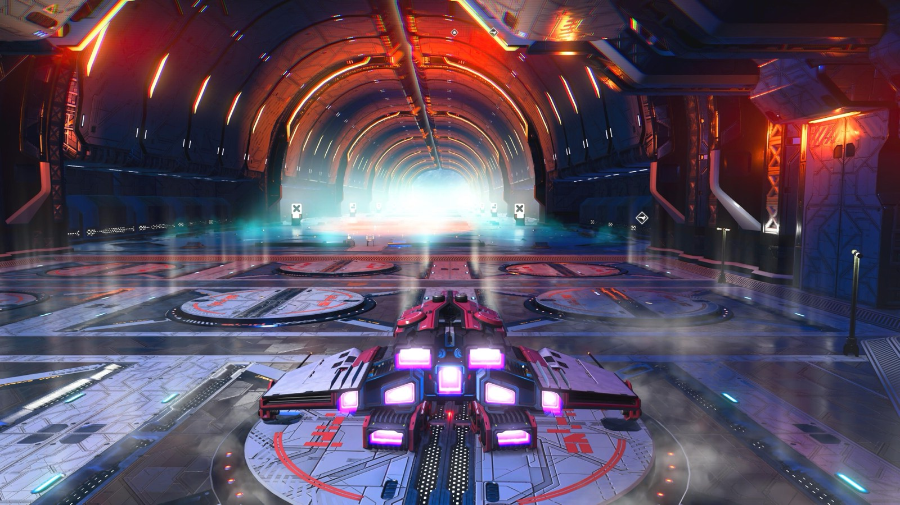
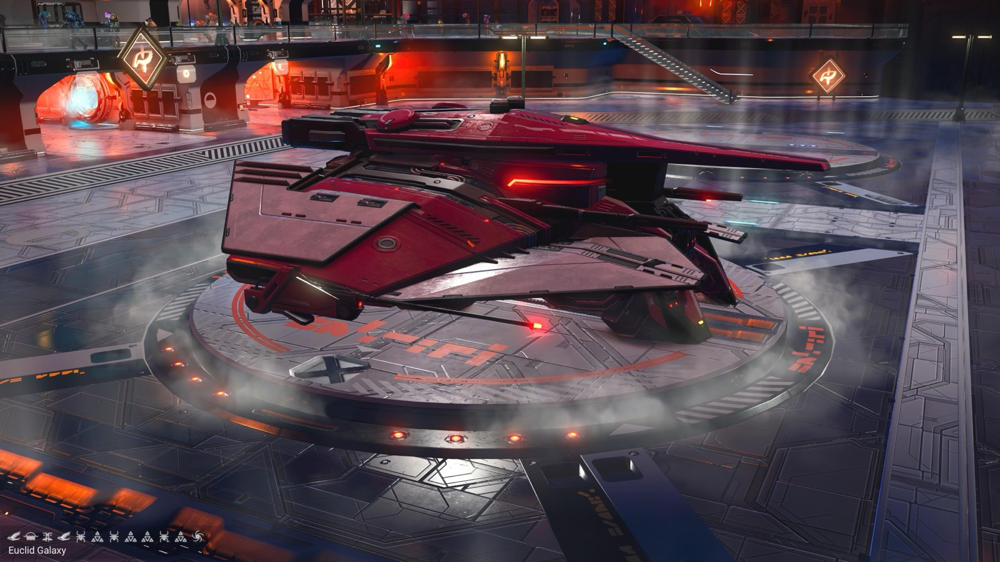
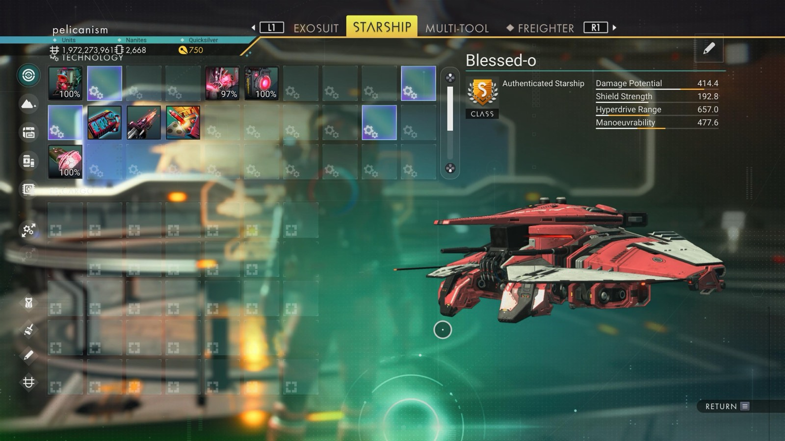

# Waypoint 1: Rikalha-Ryuga

| | |
|---|---|
| Galaxy | Euclid |
| Distance from core | 1,157,445 LY |
| Jump from previous | – LY |
| Planet coordinates | – |
| Glyphs | – |
| Ship as found | – |
| S-class ship | Blessed-ο |
| S-class stats | Damage 414.4 · Shield 192.8 · Hyperdrive 657.0 · Manoeuvrability 477.6 |

> Starting point. No scan shot in this batch.

## Caption

_Not written yet._
