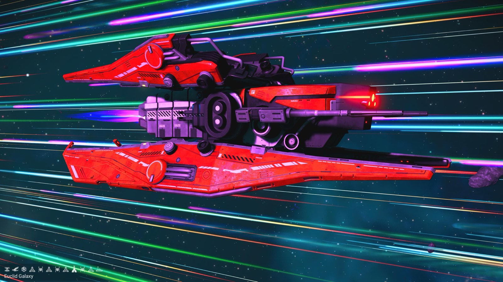
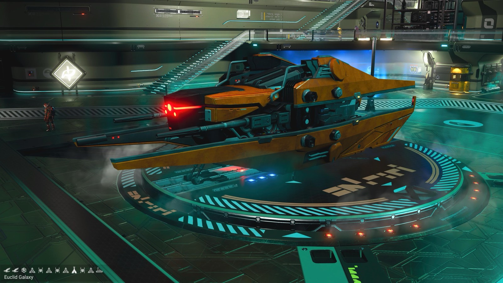
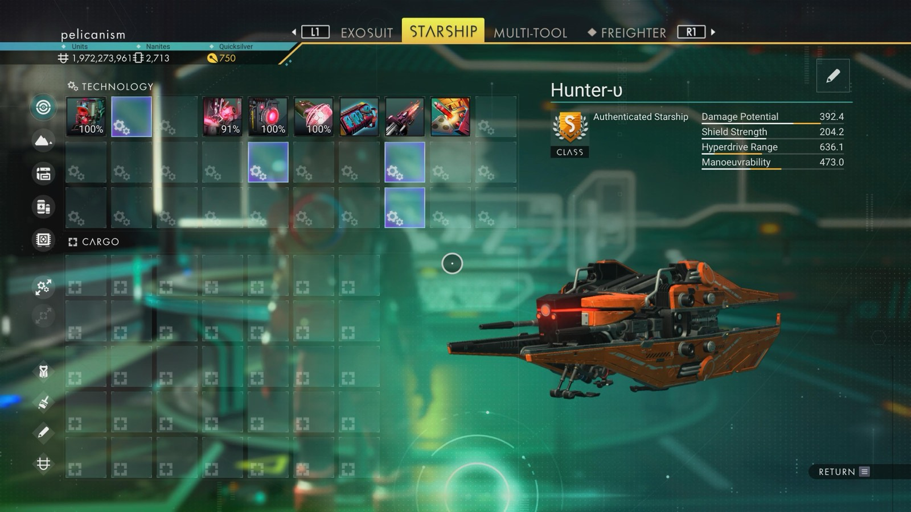

# Waypoint 2: Ozlovka-Adnyem IX

| | |
|---|---|
| Galaxy | Euclid |
| Distance from core | 1,155,598 LY |
| Jump from previous | 1,847 LY |
| Planet coordinates | +3.69, -77.95 |
| Glyphs | 11AF7F7FC7F6 |
| Ship as found | C-class, 35+24 slots |
| S-class ship | Hunter-υ |
| S-class stats | Damage 392.4 · Shield 204.2 · Hyperdrive 636.1 · Manoeuvrability 473.0 |

> No ground shot: glyphs come from the hangar, so they lead to the system rather than the ship's planet.

## Caption

_Not written yet._
