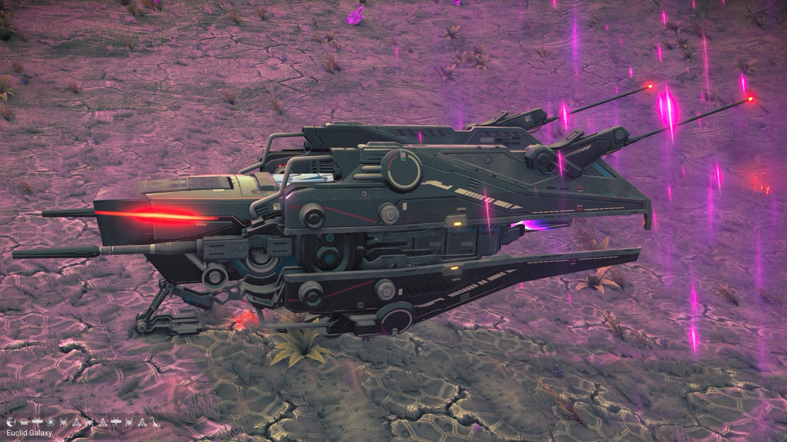
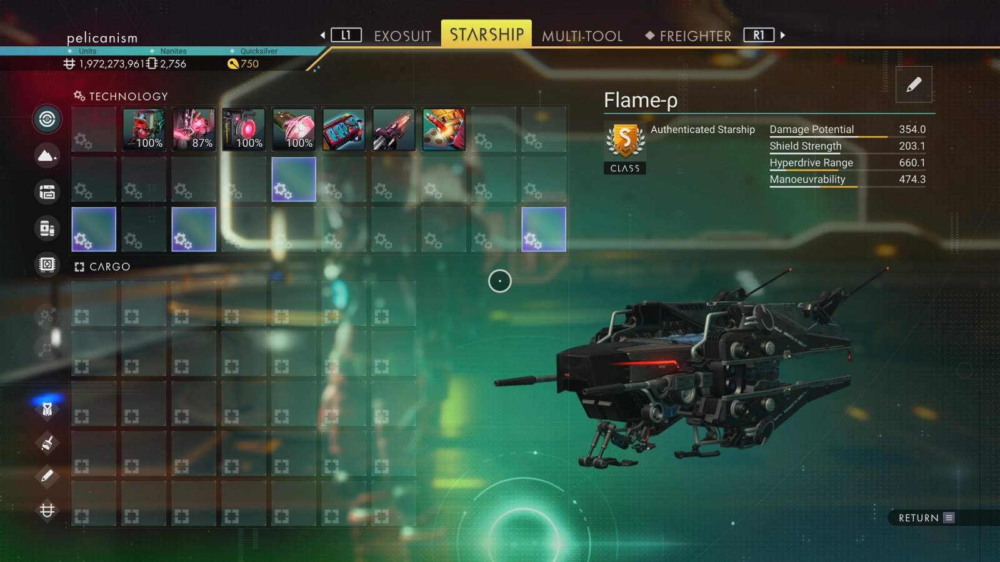
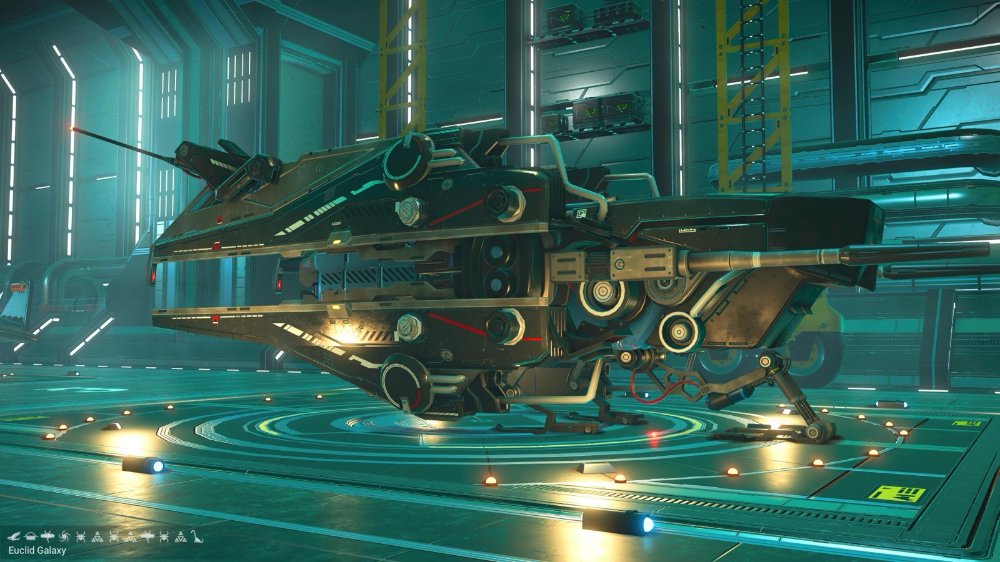

# Waypoint 3: Socarsu XIV

| | |
|---|---|
| Galaxy | Euclid |
| Distance from core | 1,153,642 LY |
| Jump from previous | 1,956 LY |
| Planet coordinates | -22.26, +154.15 |
| Glyphs | – |
| Ship as found | C-class, 35+24 slots |
| S-class ship | Flame-ρ |
| S-class stats | Damage 354.0 · Shield 203.1 · Hyperdrive 660.1 · Manoeuvrability 474.3 |

## Caption

_Not written yet._
