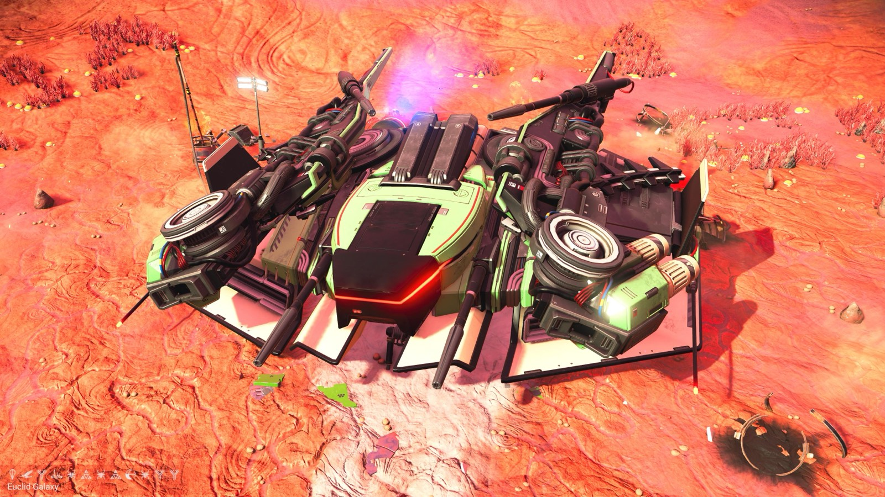
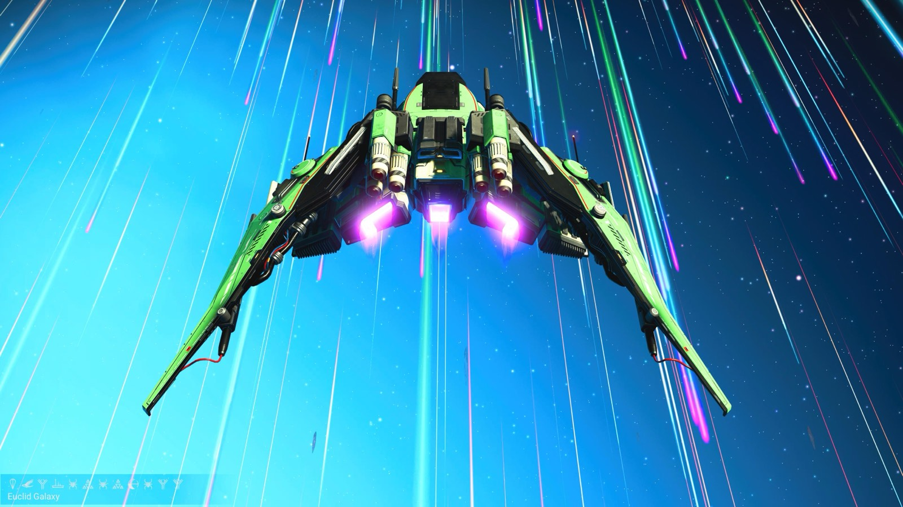
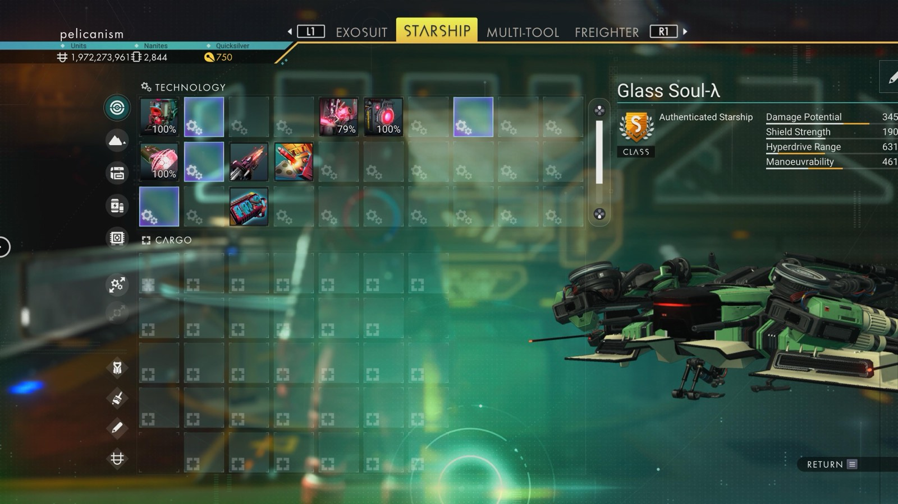

# Waypoint 4: Tachee-Unji VII

| | |
|---|---|
| Galaxy | Euclid |
| Distance from core | 1,151,262 LY |
| Jump from previous | 2,380 LY |
| Planet coordinates | +7.97, +140.65 |
| Glyphs | 51E67F7F47EE |
| Ship as found | C-class, 33+23 slots |
| S-class ship | Glass Soul-λ |
| S-class stats | Damage 345 · Shield 190 · Hyperdrive 631 · Manoeuvrability 461 |

> S-class stats are whole numbers because the screen clipped the decimals.

## Caption

_Not written yet._
