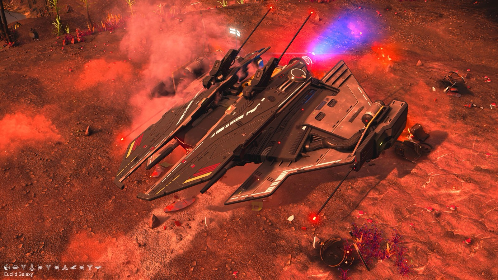
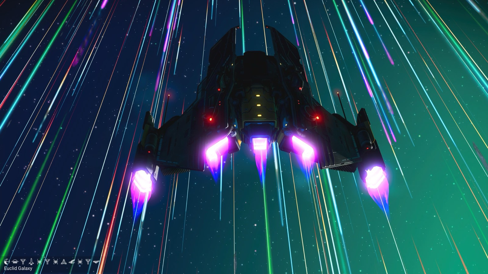
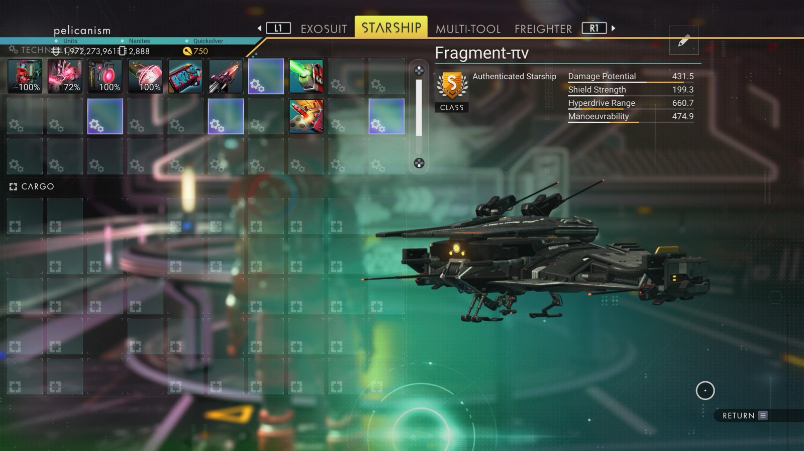

# Waypoint 5: Ogawar VII

| | |
|---|---|
| Galaxy | Euclid |
| Distance from core | 1,149,268 LY |
| Jump from previous | 1,994 LY |
| Planet coordinates | +32.04, -1.47 |
| Glyphs | 40ED7E7F17EB |
| Ship as found | B-class, 37+26 slots |
| S-class ship | Fragment-πν |
| S-class stats | Damage 431.5 · Shield 199.3 · Hyperdrive 660.7 · Manoeuvrability 474.9 |

## Caption

_Not written yet._
