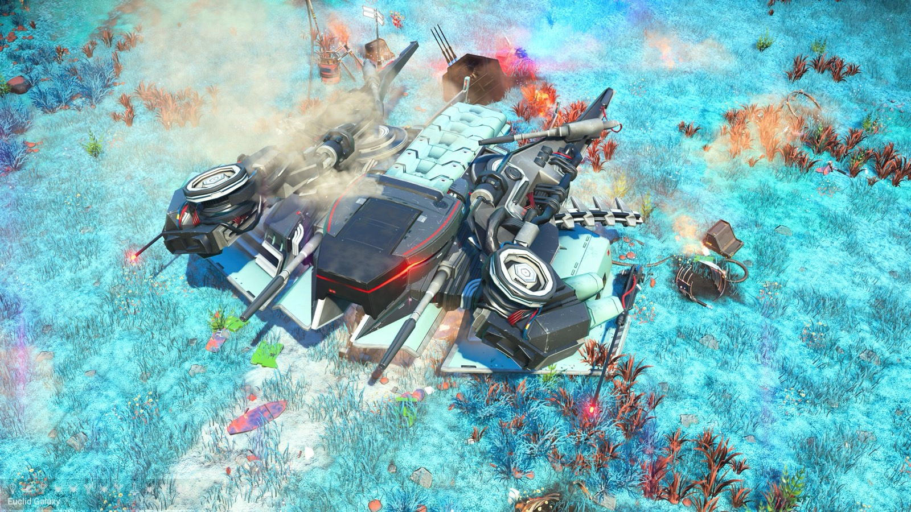
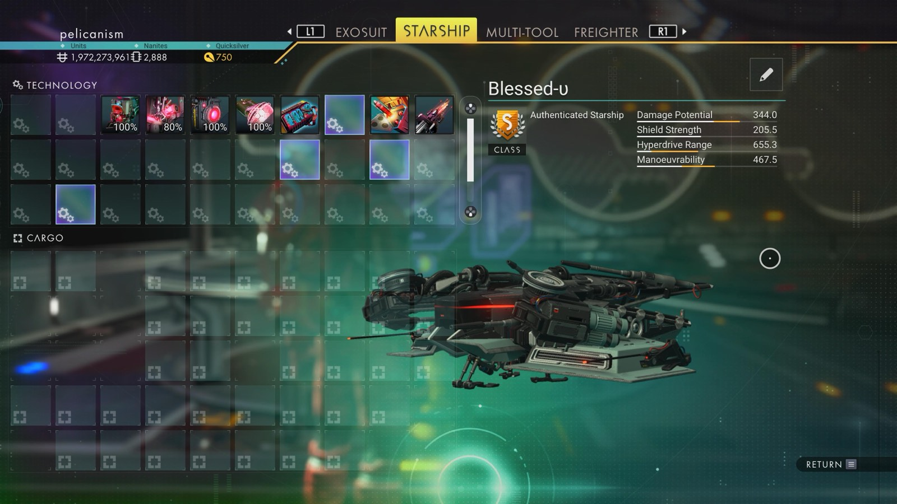

# Waypoint 6: Avressett XIV

| | |
|---|---|
| Galaxy | Euclid |
| Distance from core | 1,147,284 LY |
| Jump from previous | 1,984 LY |
| Planet coordinates | +16.11, +133.23 |
| Glyphs | 51E77E7ED7E7 |
| Ship as found | B-class, 37+26 slots |
| S-class ship | Blessed-υ |
| S-class stats | Damage 344.0 · Shield 205.5 · Hyperdrive 655.3 · Manoeuvrability 467.5 |

## Caption

_Not written yet._
