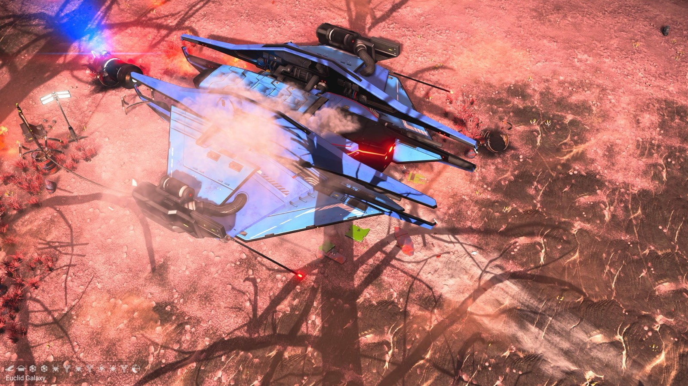
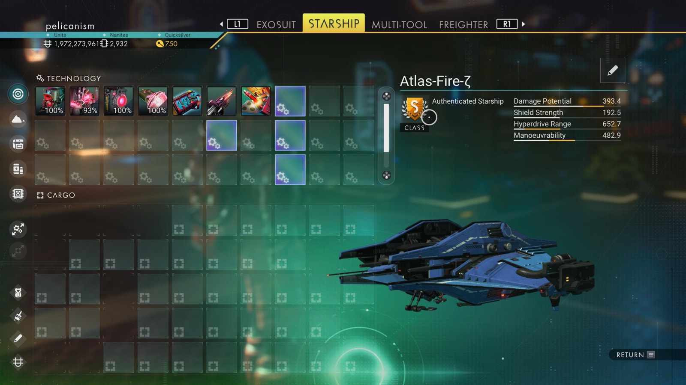

# Waypoint 7: Emiess

| | |
|---|---|
| Galaxy | Euclid |
| Distance from core | 1,145,215 LY |
| Jump from previous | 2,069 LY |
| Planet coordinates | +12.87, +50.39 |
| Glyphs | – |
| Ship as found | B-class, 38+27 slots |
| S-class ship | Atlas-Fire-ζ |
| S-class stats | Damage 393.4 · Shield 192.5 · Hyperdrive 652.7 · Manoeuvrability 482.9 |

## Caption

_Not written yet._
