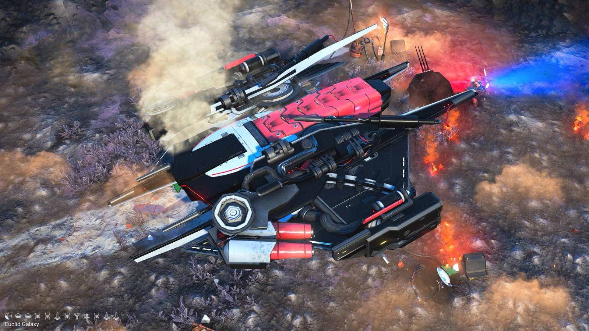
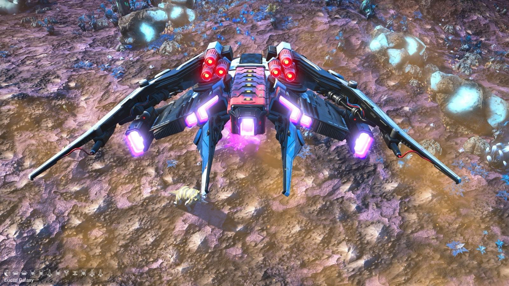
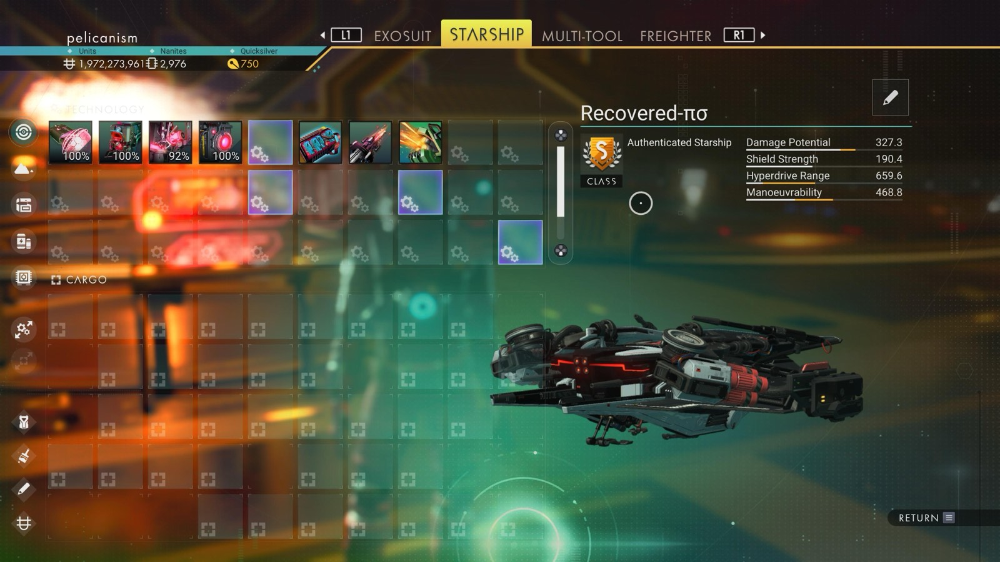

# Waypoint 8: Dabash-Yuxi

| | |
|---|---|
| Galaxy | Euclid |
| Distance from core | 1,141,469 LY |
| Jump from previous | 3,746 LY |
| Planet coordinates | +34.54, -81.33 |
| Glyphs | 40077D7E27DD |
| Ship as found | B-class, 39+27 slots |
| S-class ship | Recovered-πσ |
| S-class stats | Damage 327.3 · Shield 190.4 · Hyperdrive 659.6 · Manoeuvrability 468.8 |

> Long jump: may mean a skipped stop.

## Caption

_Not written yet._
