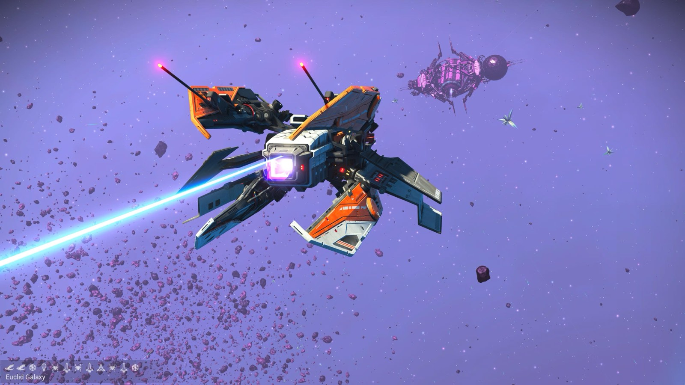
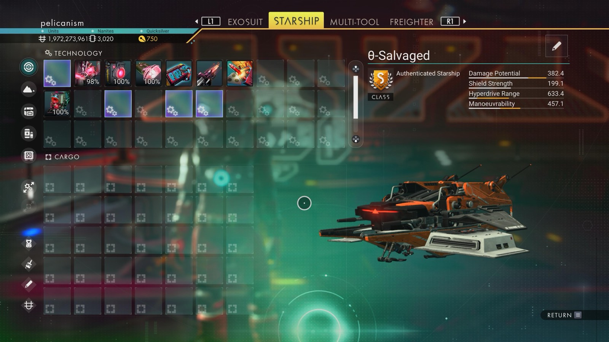

# Waypoint 9: Besanour

| | |
|---|---|
| Galaxy | Euclid |
| Distance from core | 1,139,607 LY |
| Jump from previous | 1,862 LY |
| Planet coordinates | +39.13, +36.75 |
| Glyphs | 11A57D7DF7DA |
| Ship as found | B-class, 35+24 slots |
| S-class ship | θ-Salvaged |
| S-class stats | Damage 382.4 · Shield 199.1 · Hyperdrive 633.4 · Manoeuvrability 457.1 |

## Caption

_Not written yet._
