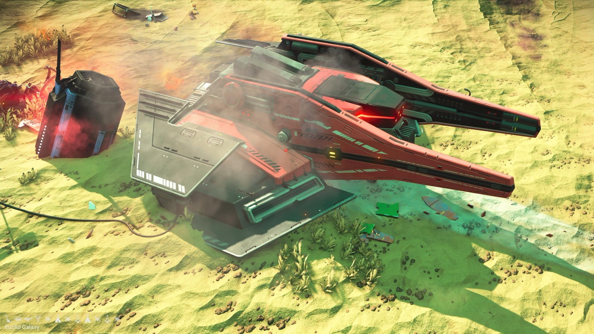
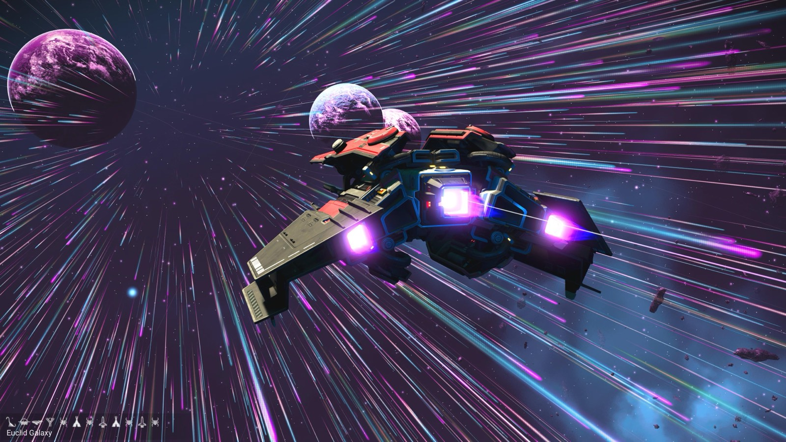
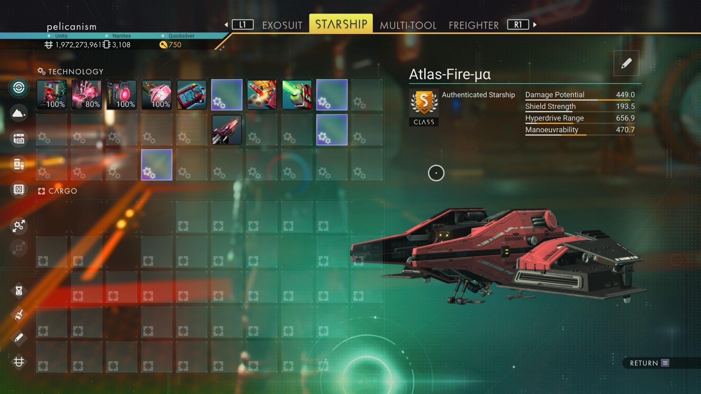

# Waypoint 10: Uchuor-Unbun

| | |
|---|---|
| Galaxy | Euclid |
| Distance from core | 1,137,740 LY |
| Jump from previous | 1,867 LY |
| Planet coordinates | -37.78, +59.85 |
| Glyphs | – |
| Ship as found | A-class, 39+28 slots |
| S-class ship | Atlas-Fire-μα |
| S-class stats | Damage 449.0 · Shield 193.5 · Hyperdrive 656.9 · Manoeuvrability 470.7 |

## Caption

_Not written yet._
