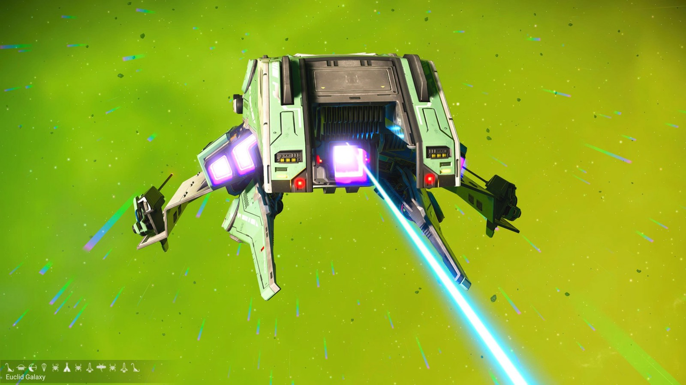
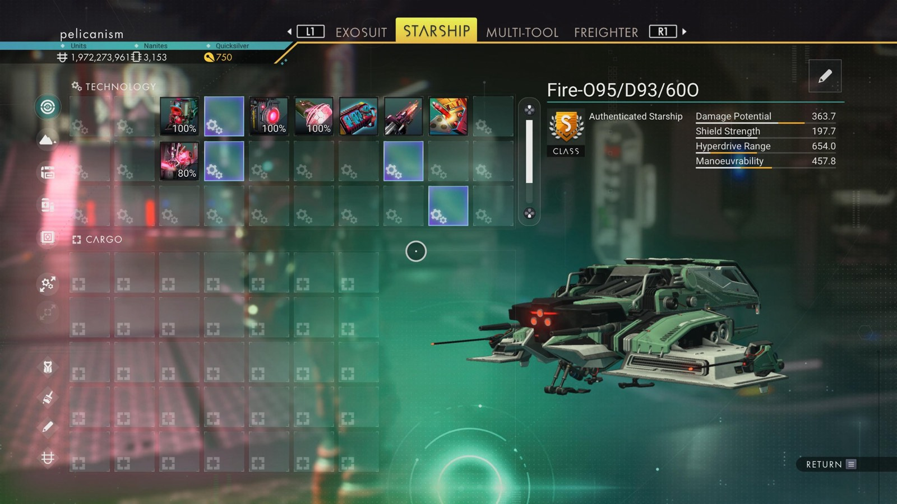

# Waypoint 11: Oetsuna

| | |
|---|---|
| Galaxy | Euclid |
| Distance from core | 1,135,700 LY |
| Jump from previous | 2,040 LY |
| Planet coordinates | -46.92, +12.73 |
| Glyphs | 30457C7D87D3 |
| Ship as found | C-class, 35+24 slots |
| S-class ship | Fire-O95/D93/600 |
| S-class stats | Damage 363.7 · Shield 197.7 · Hyperdrive 654.0 · Manoeuvrability 457.8 |

> Found as Recovered-3-62X.

## Caption

_Not written yet._
