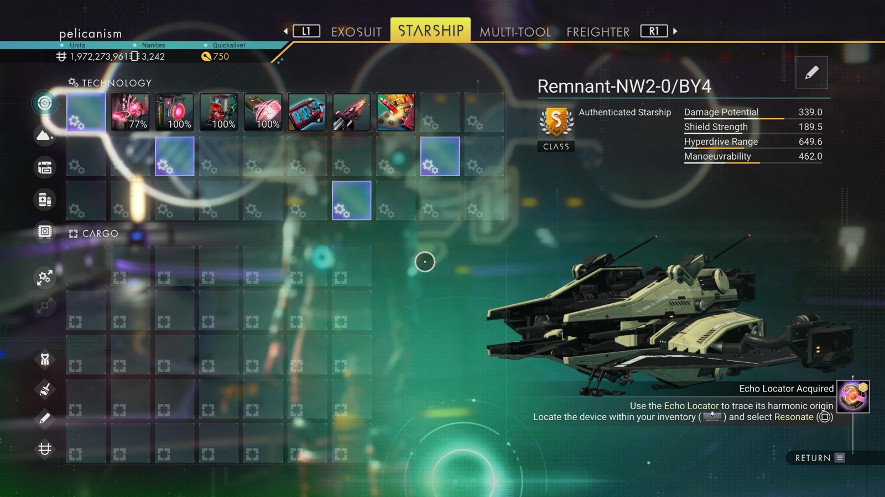

# Waypoint 12: Eharas-Zaoyu

| | |
|---|---|
| Galaxy | Euclid |
| Distance from core | 1,131,694 LY |
| Jump from previous | 4,006 LY |
| Planet coordinates | +42.97, -175.82 |
| Glyphs | 500F7C7D07CD |
| Ship as found | C-class, 34+23 slots |
| S-class ship | Remnant-NW2-0/BY4 |
| S-class stats | Damage 339.0 · Shield 189.5 · Hyperdrive 649.6 · Manoeuvrability 462.0 |

## Caption

_Not written yet._
