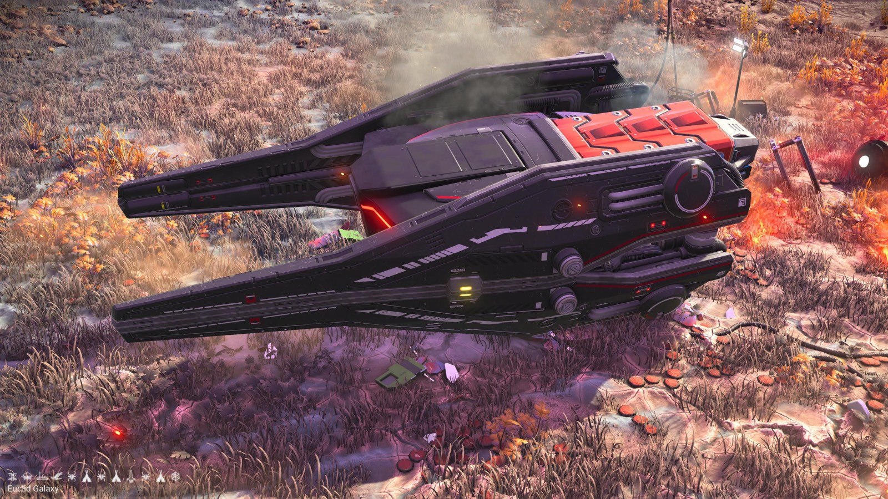
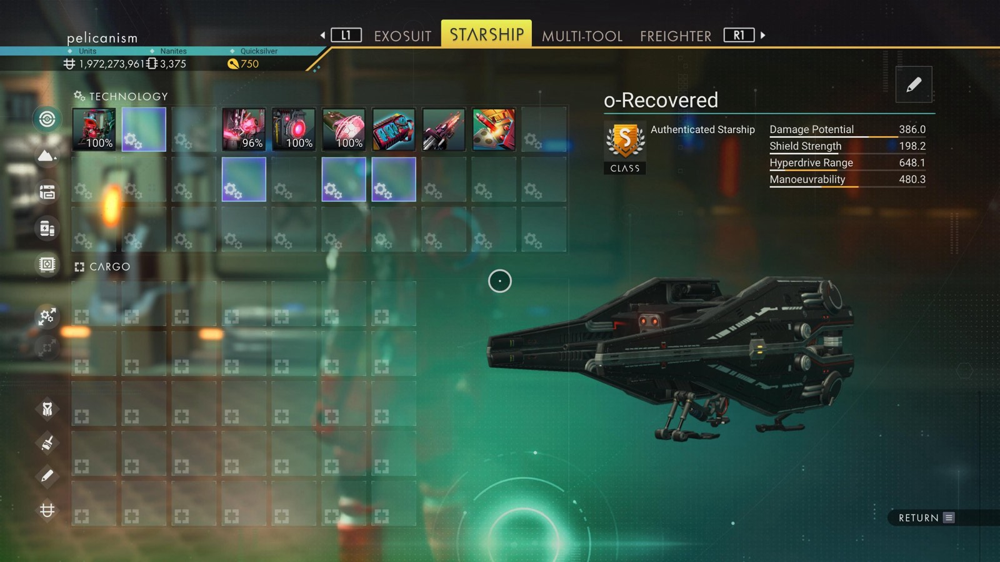

# Waypoint 13: Daobeih-Renn XVIII

| | |
|---|---|
| Galaxy | Euclid |
| Distance from core | 1,129,791 LY |
| Jump from previous | 1,903 LY |
| Planet coordinates | -36.21, +74.75 |
| Glyphs | 20617C7CD7CA |
| Ship as found | C-class, 35+24 slots |
| S-class ship | ο-Recovered |
| S-class stats | Damage 386.0 · Shield 198.2 · Hyperdrive 648.1 · Manoeuvrability 480.3 |

## Caption

_Not written yet._
