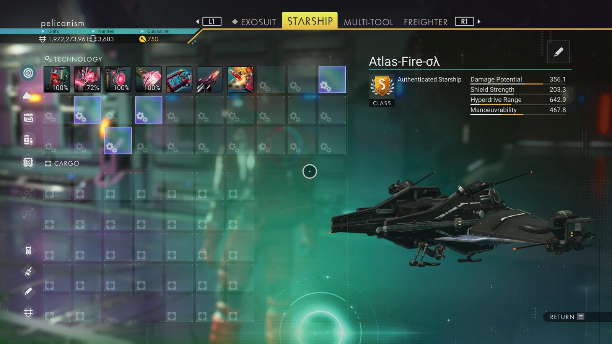

# Waypoint 14: Hadencer

| | |
|---|---|
| Galaxy | Euclid |
| Distance from core | 1,127,798 LY |
| Jump from previous | 1,993 LY |
| Planet coordinates | +30.55, -97.96 |
| Glyphs | 50FD7C7C97C7 |
| Ship as found | C-class, 33+22 slots |
| S-class ship | Atlas-Fire-σλ |
| S-class stats | Damage 356.1 · Shield 203.3 · Hyperdrive 642.9 · Manoeuvrability 467.8 |

## Caption

_Not written yet._
