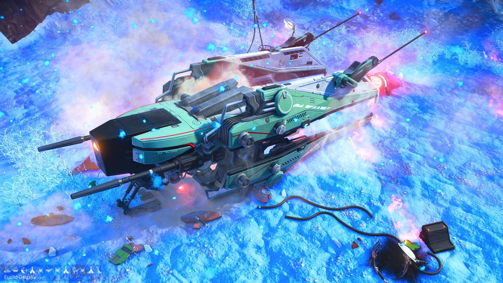
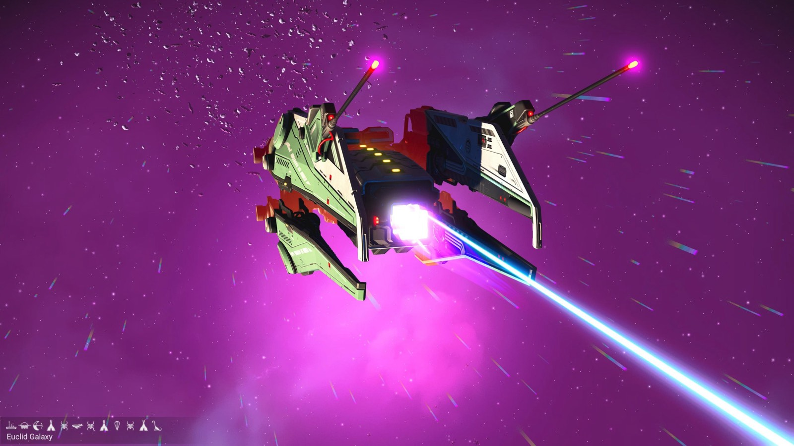
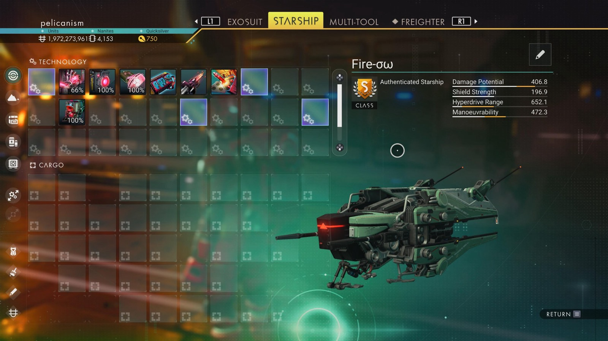

# Waypoint 15: Xigazeyn

| | |
|---|---|
| Galaxy | Euclid |
| Distance from core | 1,125,819 LY |
| Jump from previous | 1,979 LY |
| Planet coordinates | +19.34, +174.13 |
| Glyphs | 604C7B7C57C3 |
| Ship as found | B-class, 37+26 slots |
| S-class ship | Fire-σω |
| S-class stats | Damage 406.8 · Shield 196.9 · Hyperdrive 652.1 · Manoeuvrability 472.3 |

> Salvage site: planet Yetriaxin Prime.

## Caption

_Not written yet._
