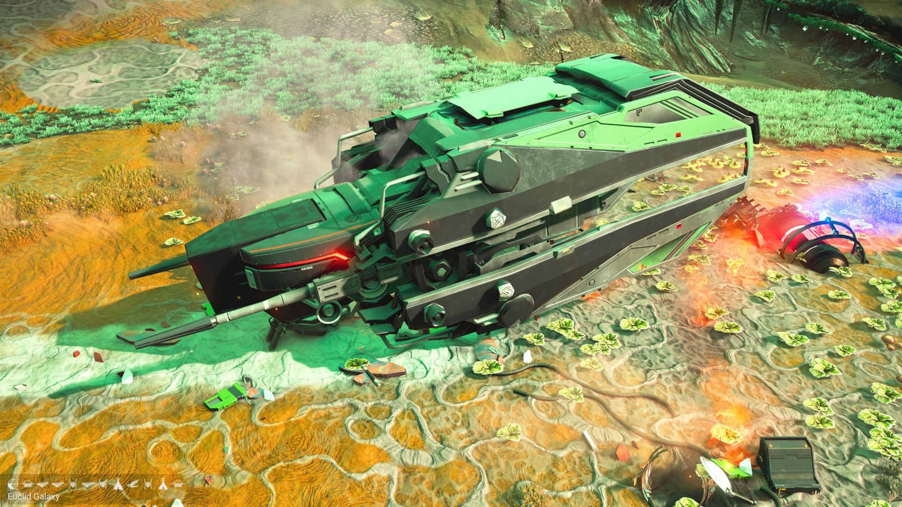
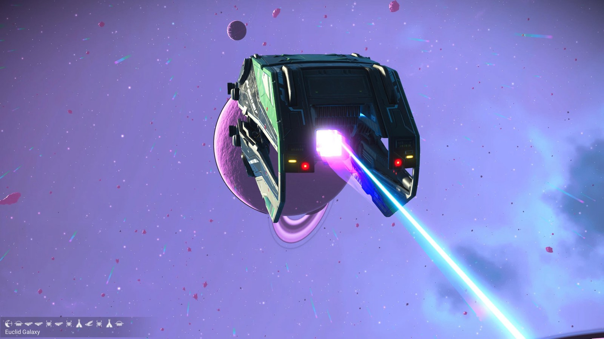
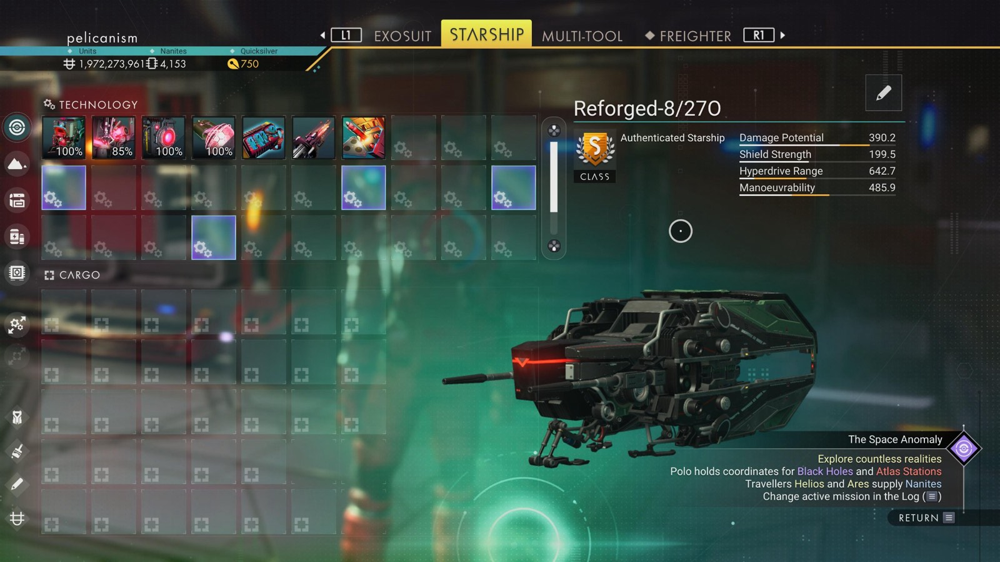

# Waypoint 16: Negport-Murit

| | |
|---|---|
| Galaxy | Euclid |
| Distance from core | 1,123,769 LY |
| Jump from previous | 2,050 LY |
| Planet coordinates | +45.81, -84.59 |
| Glyphs | 40BB7B7C17C0 |
| Ship as found | C-class, 32+22 slots |
| S-class ship | Reforged-8/270 |
| S-class stats | Damage 390.2 · Shield 199.5 · Hyperdrive 642.7 · Manoeuvrability 485.9 |

## Caption

_Not written yet._
