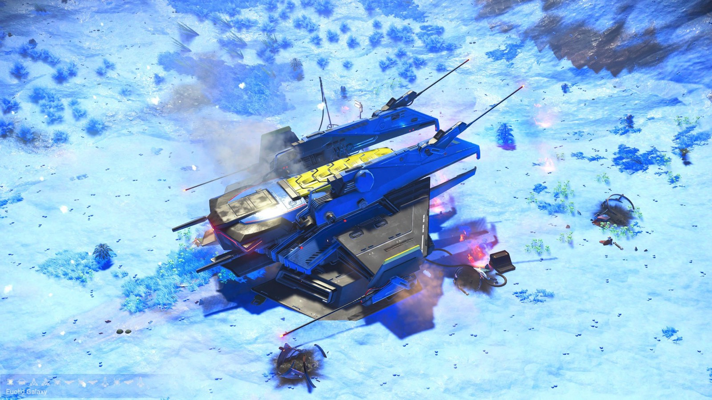
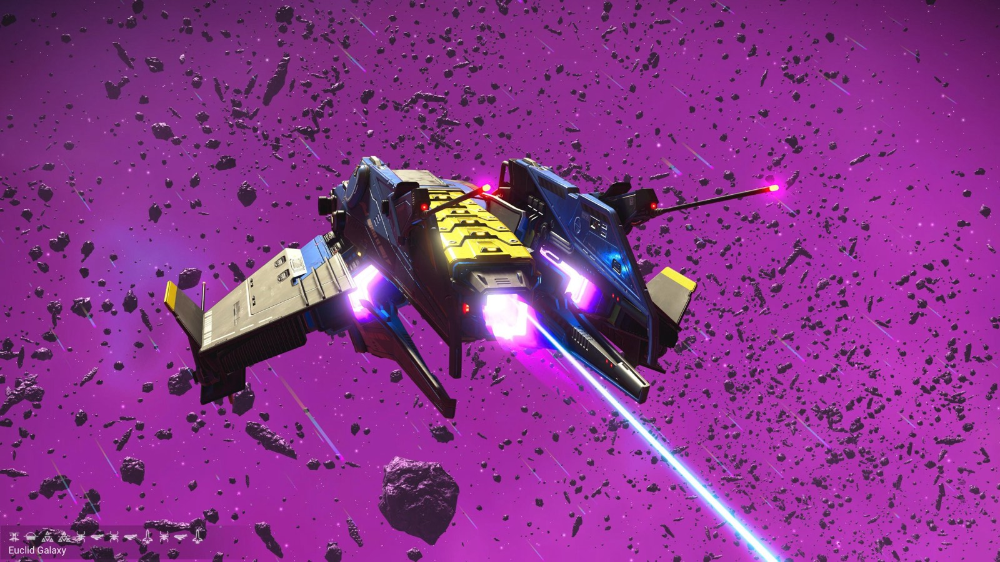
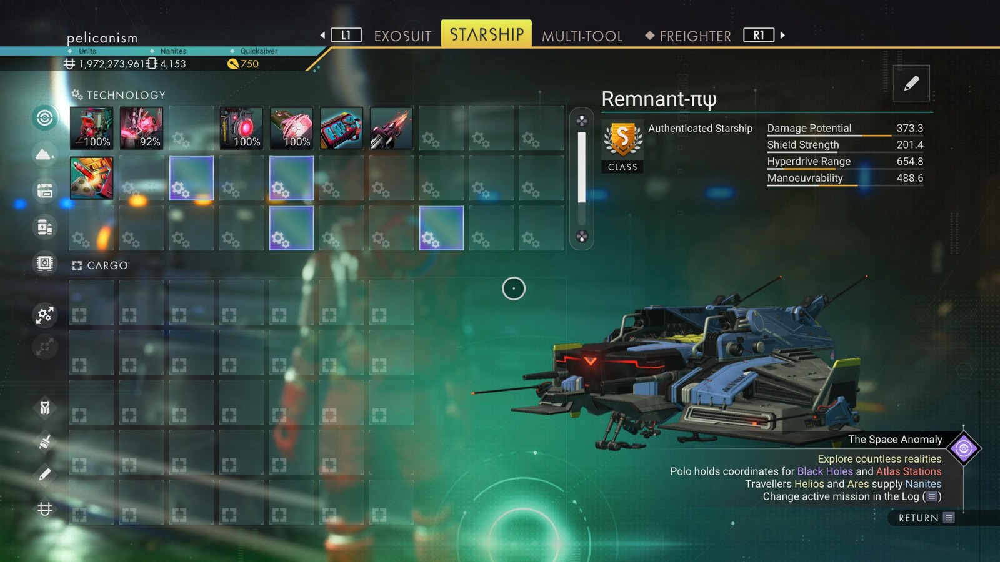

# Waypoint 17: Bushceh-Elun

| | |
|---|---|
| Galaxy | Euclid |
| Distance from core | 1,121,711 LY |
| Jump from previous | 2,058 LY |
| Planet coordinates | +32.86, +72.82 |
| Glyphs | 20FF7B7BD7BD |
| Ship as found | C-class, 34+24 slots |
| S-class ship | Remnant-πψ |
| S-class stats | Damage 373.3 · Shield 201.4 · Hyperdrive 654.8 · Manoeuvrability 488.6 |

## Caption

_Not written yet._
