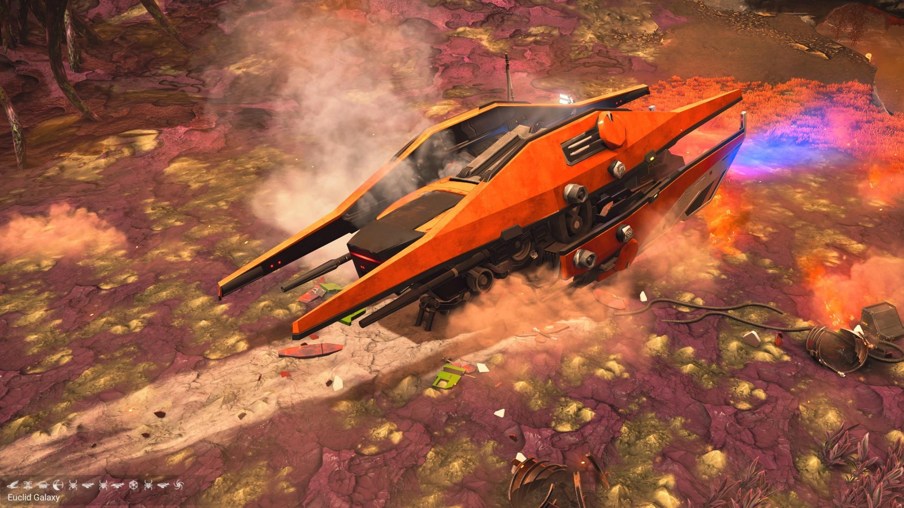
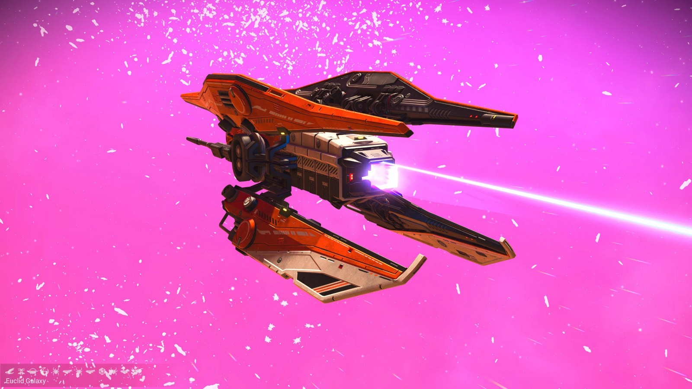
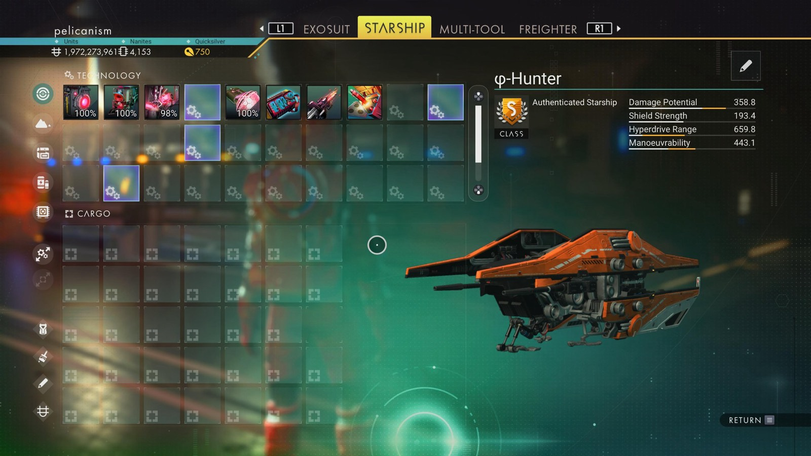

# Waypoint 18: Nutwick V

| | |
|---|---|
| Galaxy | Euclid |
| Distance from core | 1,119,848 LY |
| Jump from previous | 1,863 LY |
| Planet coordinates | -53.72, +118.11 |
| Glyphs | 12047B7BA7B9 |
| Ship as found | C-class, 34+24 slots |
| S-class ship | φ-Hunter |
| S-class stats | Damage 358.8 · Shield 193.4 · Hyperdrive 659.8 · Manoeuvrability 443.1 |

> Extreme weather salvage site (31.7 Rad protection).

## Caption

_Not written yet._
