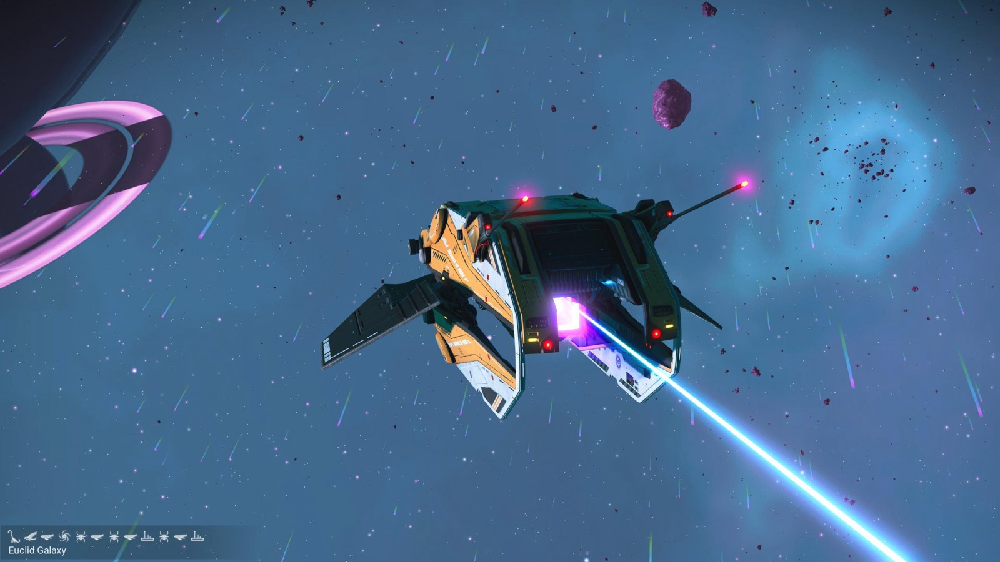
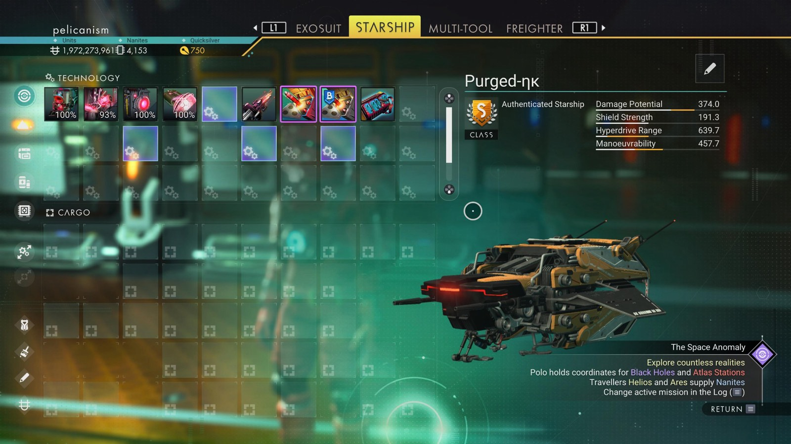

# Waypoint 19: Alachy-Guc

| | |
|---|---|
| Galaxy | Euclid |
| Distance from core | 1,117,880 LY |
| Jump from previous | 1,968 LY |
| Planet coordinates | -3.99, +40.37 |
| Glyphs | 31B97B7B67B6 |
| Ship as found | B-class, 38+27 slots |
| S-class ship | Purged-ηκ |
| S-class stats | Damage 374.0 · Shield 191.3 · Hyperdrive 639.7 · Manoeuvrability 457.7 |

> Hot salvage site (94.8 C).

## Caption

_Not written yet._
