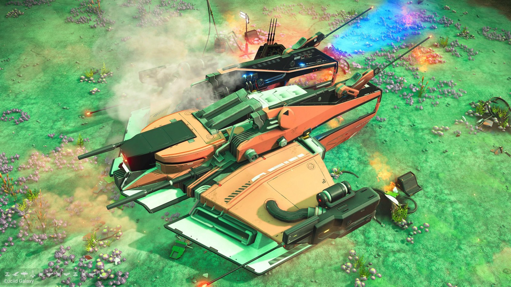
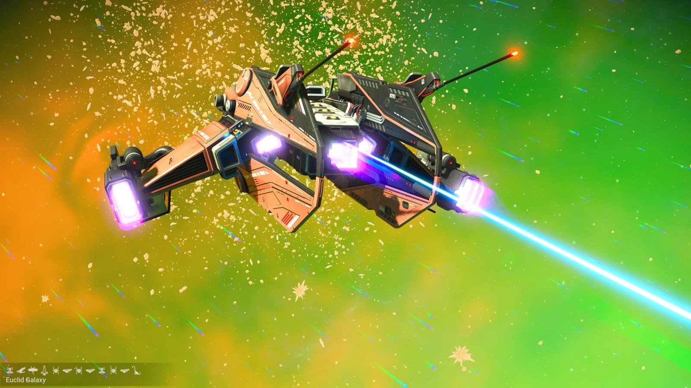
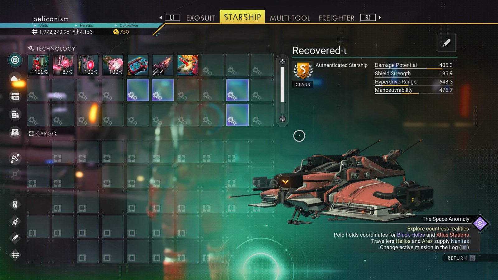

# Waypoint 20: Amotom-Toc

| | |
|---|---|
| Galaxy | Euclid |
| Distance from core | 1,115,838 LY |
| Jump from previous | 2,042 LY |
| Planet coordinates | +20.93, -117.82 |
| Glyphs | 218D7B7B27B3 |
| Ship as found | B-class, 36+25 slots |
| S-class ship | Recovered-ι |
| S-class stats | Damage 405.3 · Shield 195.9 · Hyperdrive 648.3 · Manoeuvrability 475.7 |

> Toxic salvage site (67.2 Tox).

## Caption

_Not written yet._
