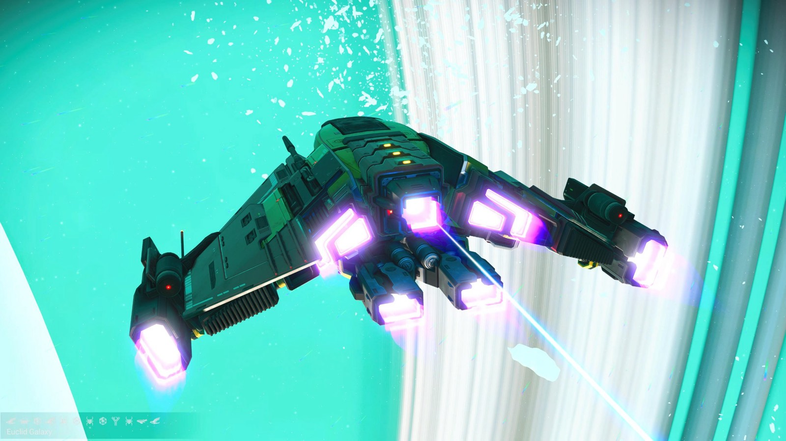
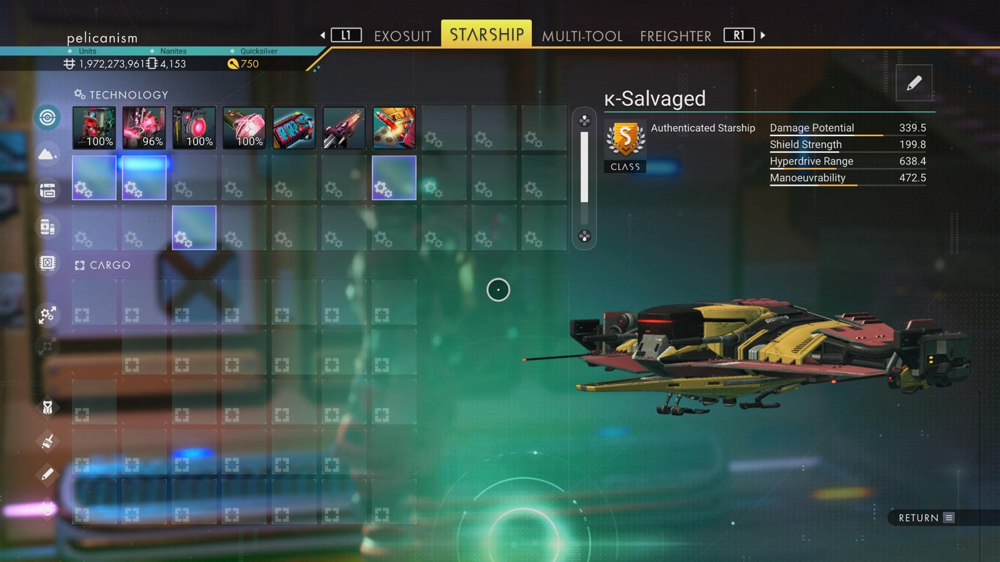

# Waypoint 21: Tamman-AMQ V

| | |
|---|---|
| Galaxy | Euclid |
| Distance from core | 1,113,997 LY |
| Jump from previous | 1,841 LY |
| Planet coordinates | +4.72, +154.19 |
| Glyphs | 10A17A7AE7B1 |
| Ship as found | C-class, 32+22 slots |
| S-class ship | κ-Salvaged |
| S-class stats | Damage 339.5 · Shield 199.8 · Hyperdrive 638.4 · Manoeuvrability 472.5 |

## Caption

_Not written yet._
