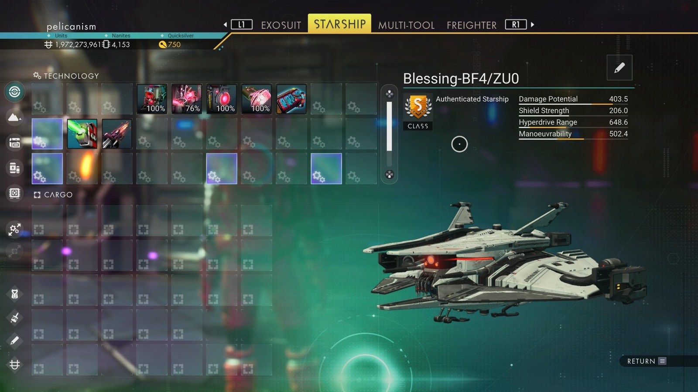

# Waypoint 22: Egutays

| | |
|---|---|
| Galaxy | Euclid |
| Distance from core | 1,111,977 LY |
| Jump from previous | 2,020 LY |
| Planet coordinates | -59.62, +19.33 |
| Glyphs | 60097A7AB7AD |
| Ship as found | C-class, 32+22 slots |
| S-class ship | Blessing-BF4/ZU0 |
| S-class stats | Damage 403.5 · Shield 206.0 · Hyperdrive 648.6 · Manoeuvrability 502.4 |

## Caption

_Not written yet._
