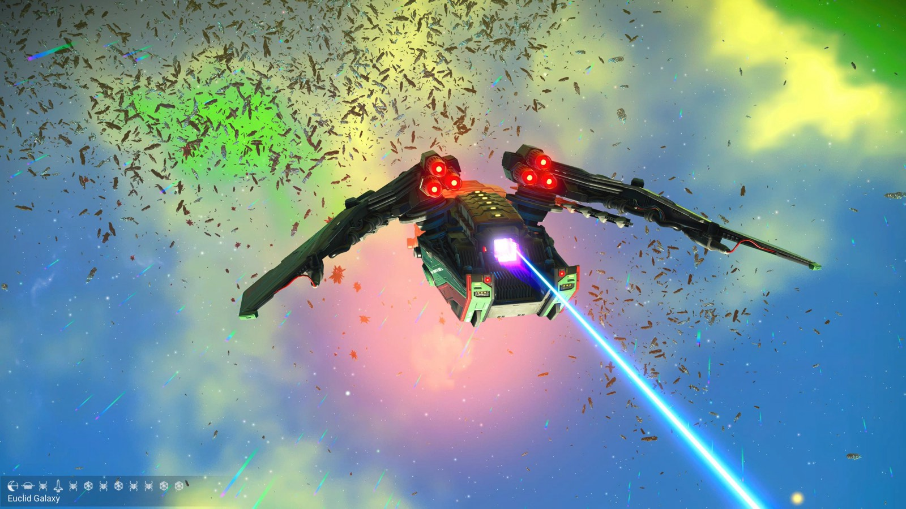
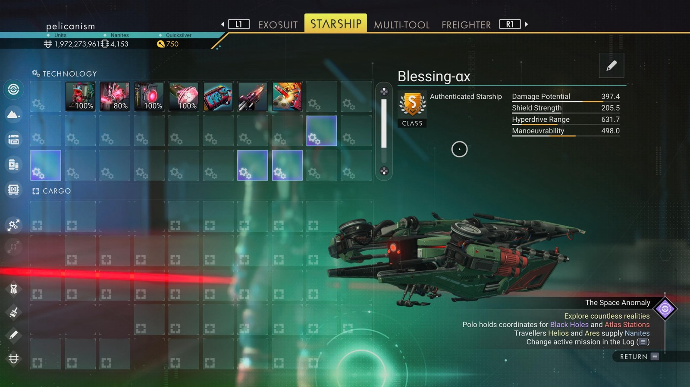

# Waypoint 23: Tuvaley VI

| | |
|---|---|
| Galaxy | Euclid |
| Distance from core | 1,110,138 LY |
| Jump from previous | 1,839 LY |
| Planet coordinates | +23.85, +175.59 |
| Glyphs | 407D7A7A77AA |
| Ship as found | B-class, 39+27 slots |
| S-class ship | Blessing-αx |
| S-class stats | Damage 397.4 · Shield 205.5 · Hyperdrive 631.7 · Manoeuvrability 498.0 |

## Caption

_Not written yet._
