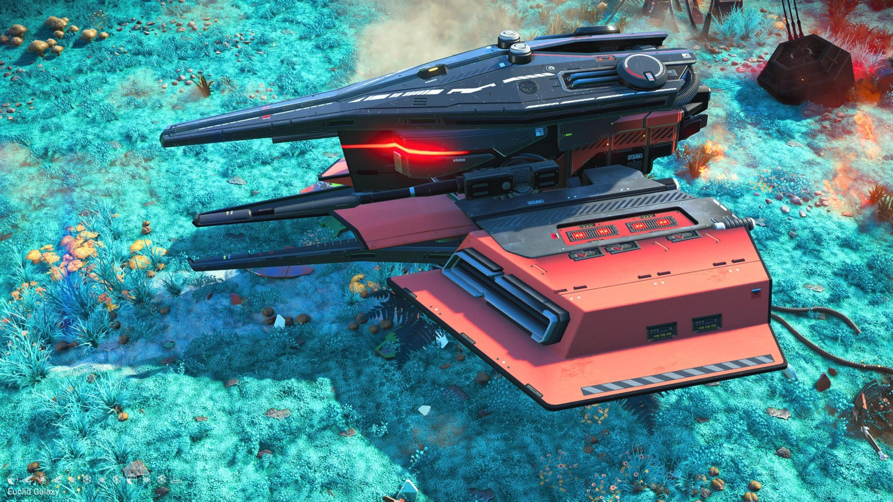
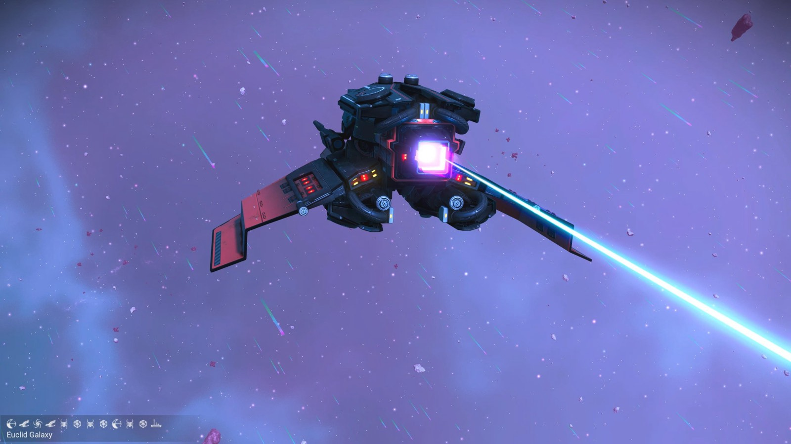
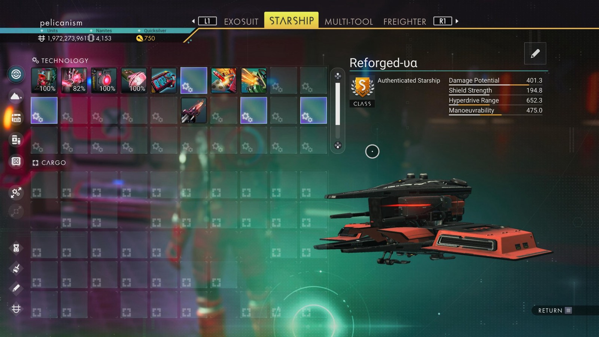

# Waypoint 24: Imechn-Rafa XVI

| | |
|---|---|
| Galaxy | Euclid |
| Distance from core | 1,108,168 LY |
| Jump from previous | 1,970 LY |
| Planet coordinates | +19.84, +78.76 |
| Glyphs | 41917A7A47A6 |
| Ship as found | A-class, 40+28 slots |
| S-class ship | Reforged-υα |
| S-class stats | Damage 401.3 · Shield 194.8 · Hyperdrive 652.3 · Manoeuvrability 475.0 |

## Caption

_Not written yet._
