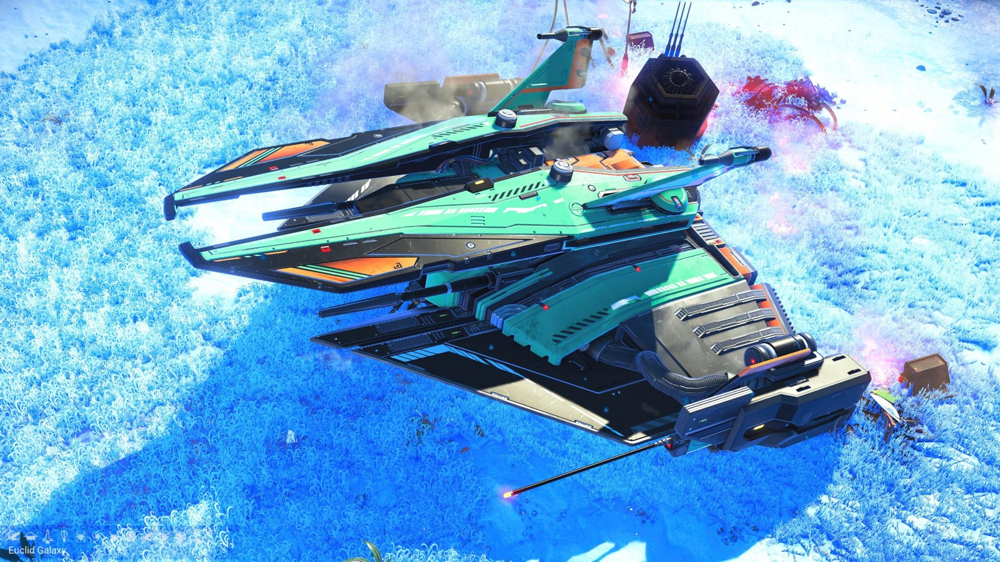
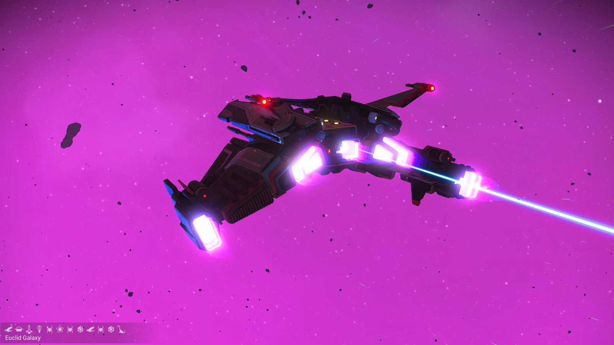
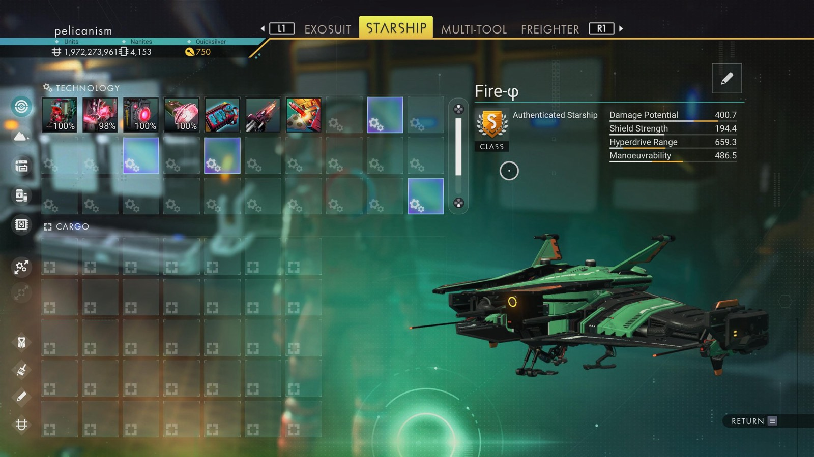

# Waypoint 25: Lucheoka

| | |
|---|---|
| Galaxy | Euclid |
| Distance from core | 1,106,294 LY |
| Jump from previous | 1,874 LY |
| Planet coordinates | +64.15, -132.97 |
| Glyphs | 10D5797A17A3 |
| Ship as found | C-class, 35+24 slots |
| S-class ship | Fire-φ |
| S-class stats | Damage 400.7 · Shield 194.4 · Hyperdrive 659.3 · Manoeuvrability 486.5 |

> Found as Crimson-W27/67I.

## Caption

_Not written yet._
