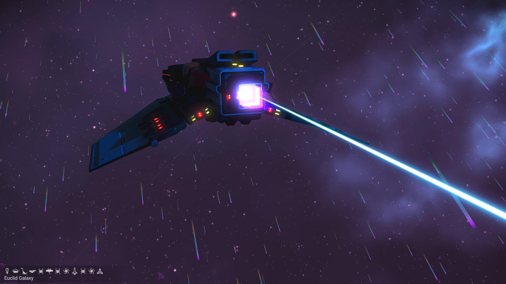
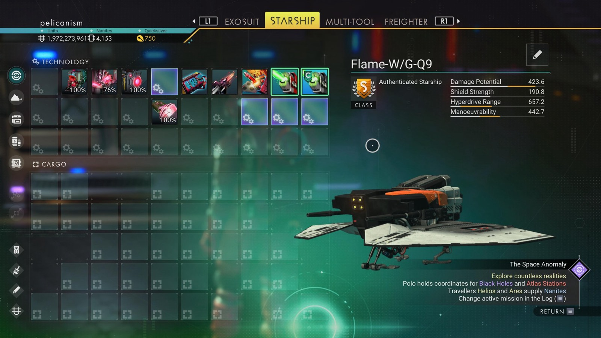

# Waypoint 26: Ionart

| | |
|---|---|
| Galaxy | Euclid |
| Distance from core | 1,104,248 LY |
| Jump from previous | 2,046 LY |
| Planet coordinates | -19.07, -44.78 |
| Glyphs | 503B7879D79F |
| Ship as found | A-class, 39+27 slots |
| S-class ship | Flame-W/G-Q9 |
| S-class stats | Damage 423.6 · Shield 190.8 · Hyperdrive 657.2 · Manoeuvrability 442.7 |

## Caption

_Not written yet._
