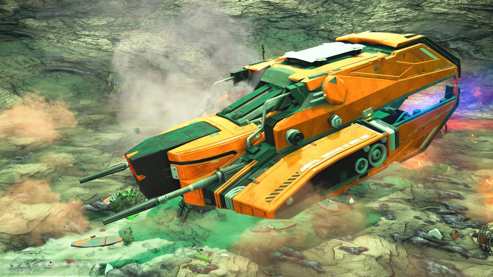
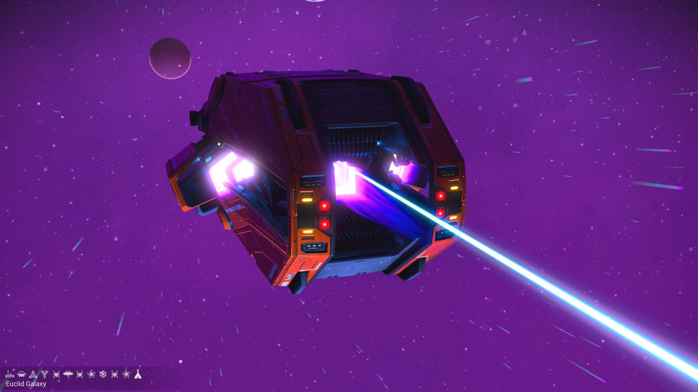
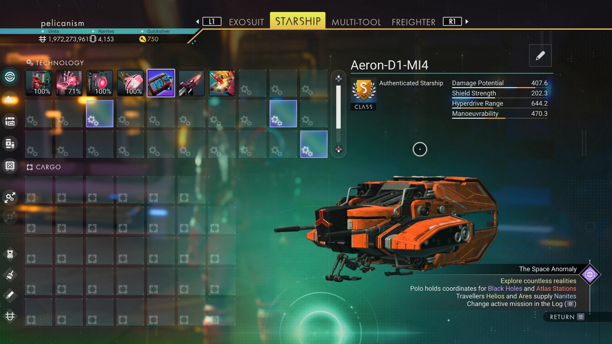

# Waypoint 27: Eceles VI

| | |
|---|---|
| Galaxy | Euclid |
| Distance from core | 1,102,428 LY |
| Jump from previous | 1,820 LY |
| Planet coordinates | -46.73, -135.98 |
| Glyphs | 60FE7879A79C |
| Ship as found | C-class, 34+23 slots |
| S-class ship | Aeron-D1-MI4 |
| S-class stats | Damage 407.6 · Shield 202.3 · Hyperdrive 644.2 · Manoeuvrability 470.3 |

## Caption

_Not written yet._
