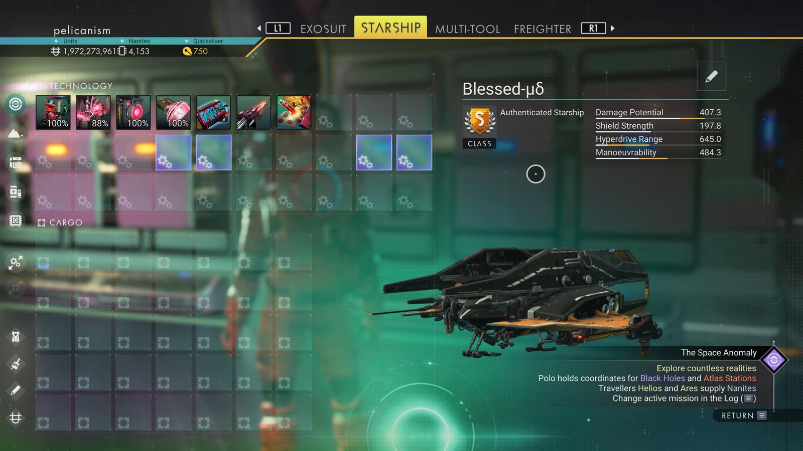

# Waypoint 28: Aniiati-Luoy XIV

| | |
|---|---|
| Galaxy | Euclid |
| Distance from core | 1,100,385 LY |
| Jump from previous | 2,043 LY |
| Planet coordinates | -31.44, +2.22 |
| Glyphs | 21E377796798 |
| Ship as found | C-class, 35+24 slots |
| S-class ship | Blessed-μδ |
| S-class stats | Damage 407.3 · Shield 197.8 · Hyperdrive 645.0 · Manoeuvrability 484.3 |

## Caption

_Not written yet._
