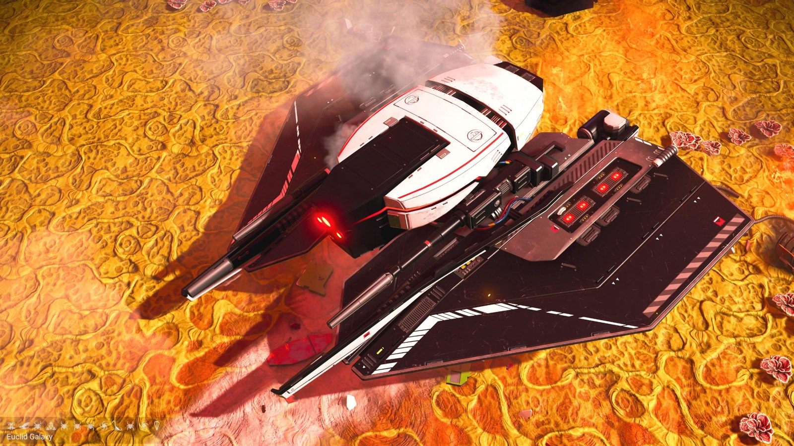
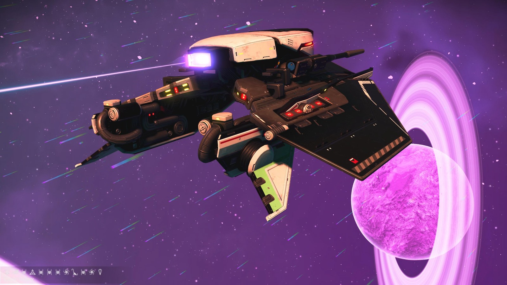
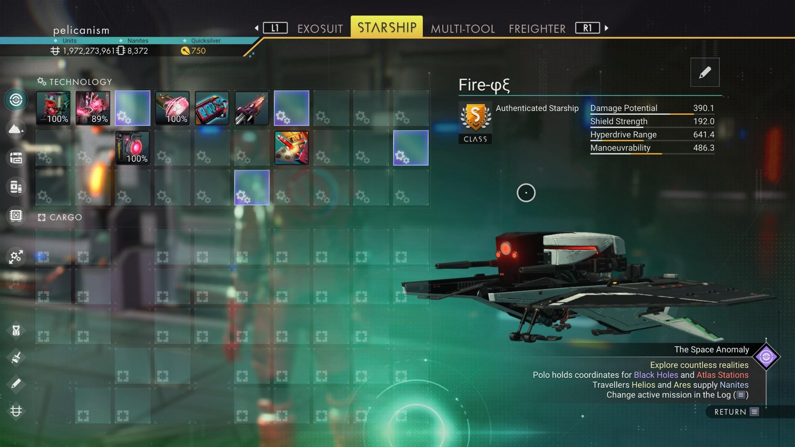

# Waypoint 29: Rehnqu

| | |
|---|---|
| Galaxy | Euclid |
| Distance from core | 1,098,414 LY |
| Jump from previous | 1,971 LY |
| Planet coordinates | +5.85, +119.50 |
| Glyphs | 217F77793795 |
| Ship as found | A-class, 40+28 slots |
| S-class ship | Fire-φξ |
| S-class stats | Damage 390.1 · Shield 192.0 · Hyperdrive 641.4 · Manoeuvrability 486.3 |

## Caption

_Not written yet._
