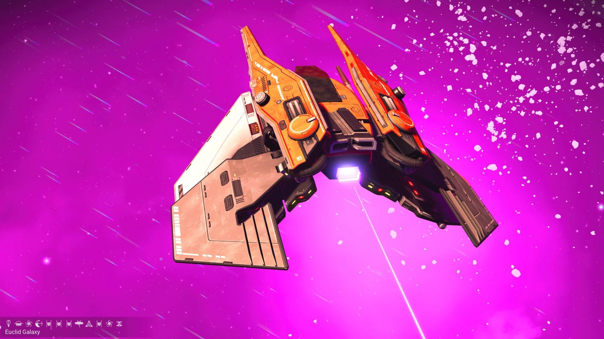
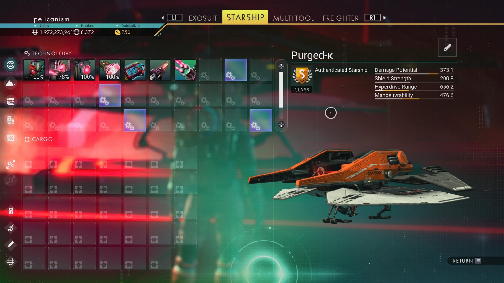

# Waypoint 30: Cixing

| | |
|---|---|
| Galaxy | Euclid |
| Distance from core | 1,096,425 LY |
| Jump from previous | 1,989 LY |
| Planet coordinates | +52.58, +142.04 |
| Glyphs | 50947778F792 |
| Ship as found | C-class, 34+24 slots |
| S-class ship | Purged-κ |
| S-class stats | Damage 373.1 · Shield 200.8 · Hyperdrive 656.2 · Manoeuvrability 476.6 |

## Caption

_Not written yet._
