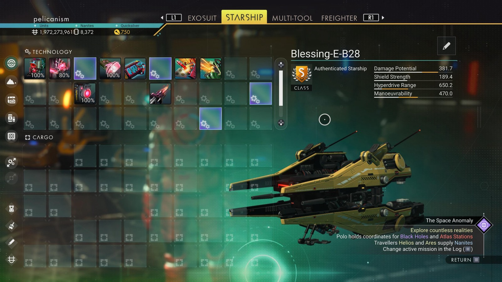

# Waypoint 31: Gasgeist XIX

| | |
|---|---|
| Galaxy | Euclid |
| Distance from core | 1,094,364 LY |
| Jump from previous | 2,061 LY |
| Planet coordinates | -88.32, +90.53 |
| Glyphs | 514C7678B78E |
| Ship as found | A-class, 40+28 slots |
| S-class ship | Blessing-E-B28 |
| S-class stats | Damage 381.7 · Shield 189.4 · Hyperdrive 650.2 · Manoeuvrability 470.0 |

## Caption

_Not written yet._
