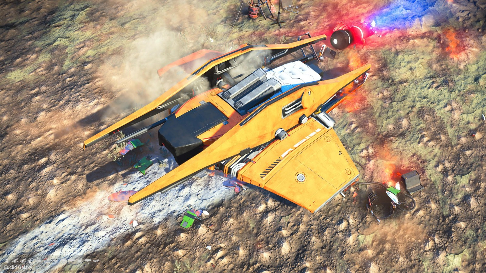
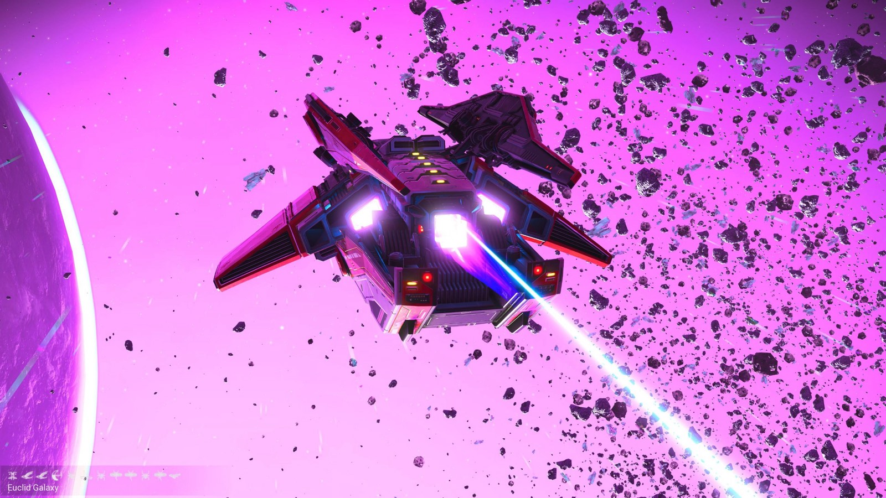
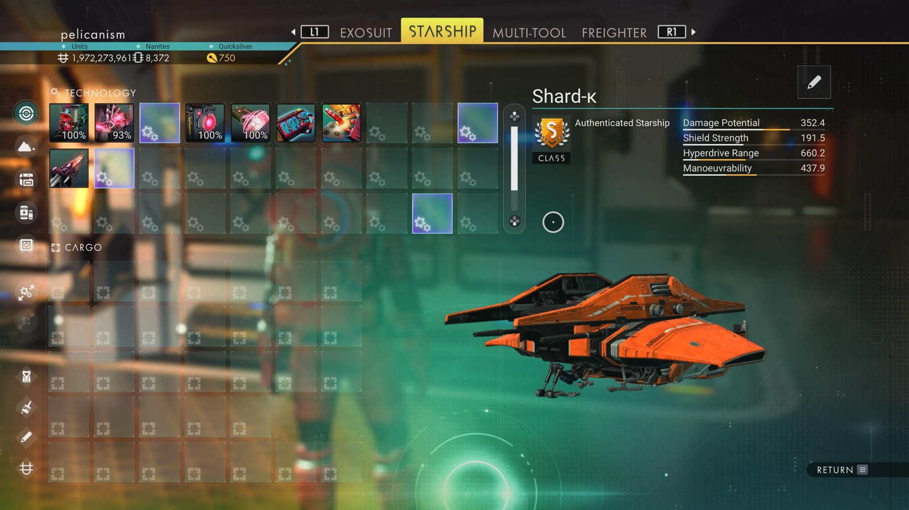

# Waypoint 32: Devidiu

| | |
|---|---|
| Galaxy | Euclid |
| Distance from core | 1,092,493 LY |
| Jump from previous | 1,871 LY |
| Planet coordinates | +34.19, +13.58 |
| Glyphs | 21147678878B |
| Ship as found | C-class, 33+23 slots |
| S-class ship | Shard-κ |
| S-class stats | Damage 352.4 · Shield 191.5 · Hyperdrive 660.2 · Manoeuvrability 437.9 |

## Caption

_Not written yet._
