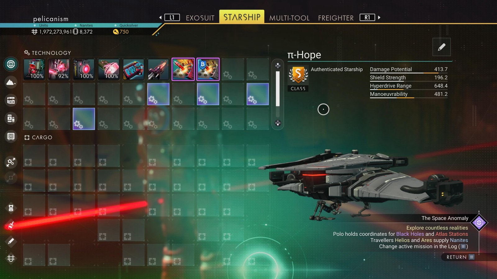

# Waypoint 33: Tuyrnyan

| | |
|---|---|
| Galaxy | Euclid |
| Distance from core | 1,090,677 LY |
| Jump from previous | 1,816 LY |
| Planet coordinates | +0.96, +131.90 |
| Glyphs | 21E976784788 |
| Ship as found | C-class, 38+27 slots |
| S-class ship | π-Hope |
| S-class stats | Damage 413.7 · Shield 196.2 · Hyperdrive 648.4 · Manoeuvrability 481.2 |

## Caption

_Not written yet._
