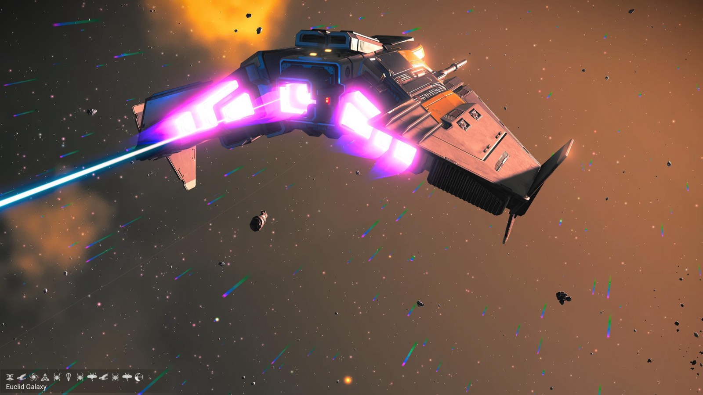
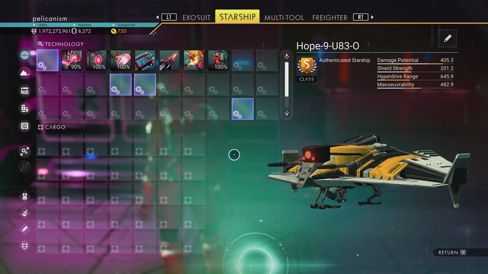

# Waypoint 34: Sopinen

| | |
|---|---|
| Galaxy | Euclid |
| Distance from core | 1,088,628 LY |
| Jump from previous | 2,049 LY |
| Planet coordinates | +17.36, -57.95 |
| Glyphs | 219F75781784 |
| Ship as found | C-class, 35+24 slots |
| S-class ship | Hope-9-U83-O |
| S-class stats | Damage 405.3 · Shield 201.2 · Hyperdrive 645.9 · Manoeuvrability 482.9 |

> Found as π-Blessed.

## Caption

_Not written yet._
