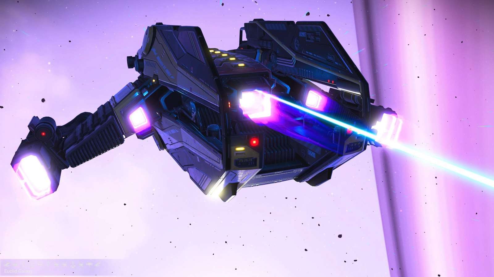
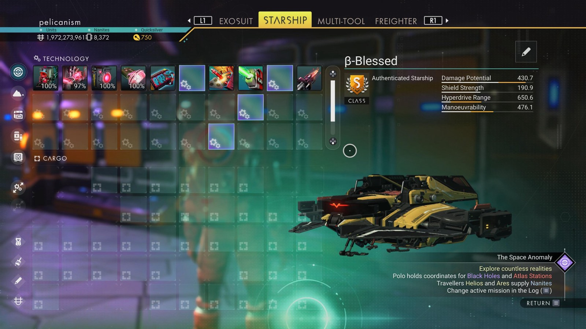

# Waypoint 35: Mobokuch VI

| | |
|---|---|
| Galaxy | Euclid |
| Distance from core | 1,086,561 LY |
| Jump from previous | 2,067 LY |
| Planet coordinates | +41.46, -164.27 |
| Glyphs | 10ED7577D781 |
| Ship as found | B-class, 38+27 slots |
| S-class ship | β-Blessed |
| S-class stats | Damage 430.7 · Shield 190.9 · Hyperdrive 650.6 · Manoeuvrability 476.1 |

> Found as Salvaged-W29-14C.

## Caption

_Not written yet._
