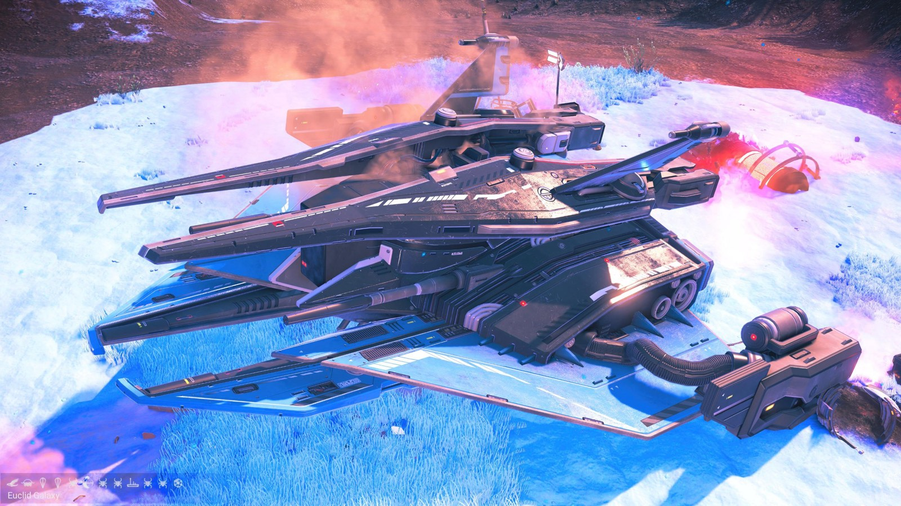
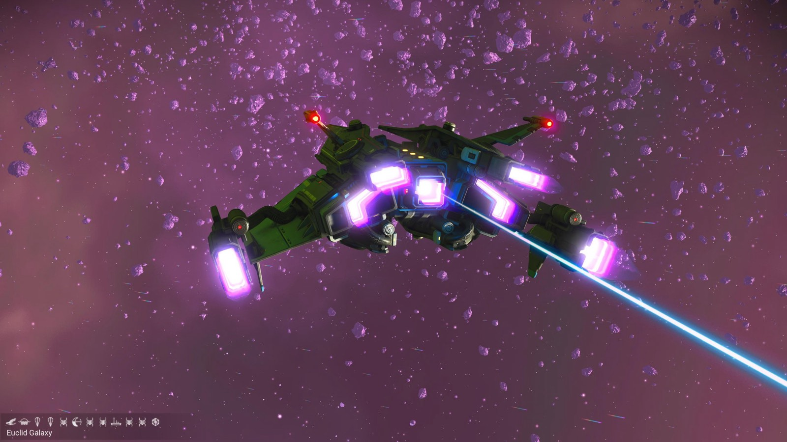
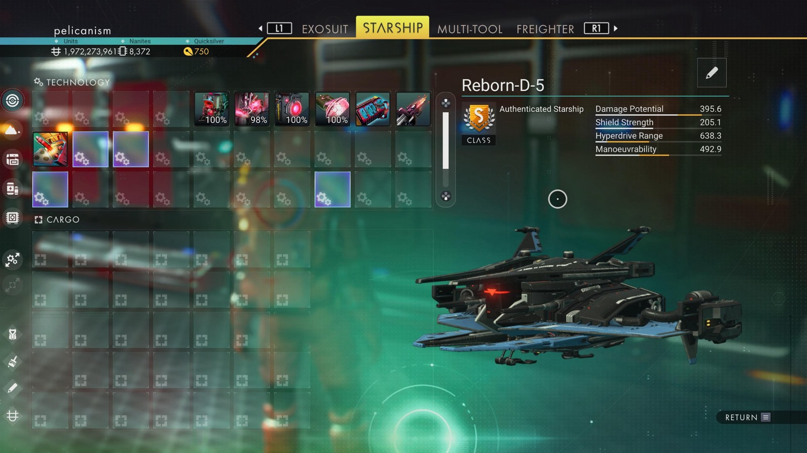

# Waypoint 36: Limdali I

| | |
|---|---|
| Galaxy | Euclid |
| Distance from core | 1,082,658 LY |
| Jump from previous | 3,903 LY |
| Planet coordinates | +28.14, -14.95 |
| Glyphs | 10557477677A |
| Ship as found | C-class, 33+23 slots |
| S-class ship | Reborn-D-5 |
| S-class stats | Damage 395.6 · Shield 205.1 · Hyperdrive 638.3 · Manoeuvrability 492.9 |

> Found as Purged-ψθ.

## Caption

_Not written yet._
