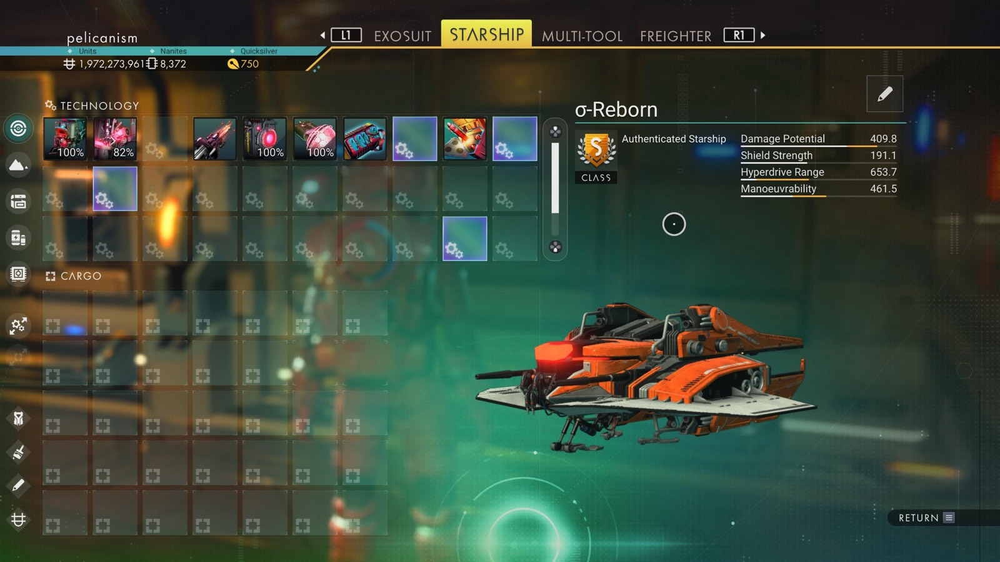

# Waypoint 37: Urnhaloc

| | |
|---|---|
| Galaxy | Euclid |
| Distance from core | 1,078,529 LY |
| Jump from previous | 4,129 LY |
| Planet coordinates | -20.15, +95.81 |
| Glyphs | 40E67476F773 |
| Ship as found | C-class, 33+23 slots |
| S-class ship | σ-Reborn |
| S-class stats | Damage 409.8 · Shield 191.1 · Hyperdrive 653.7 · Manoeuvrability 461.5 |

> Found as Blessing-ττ.

## Caption

_Not written yet._
