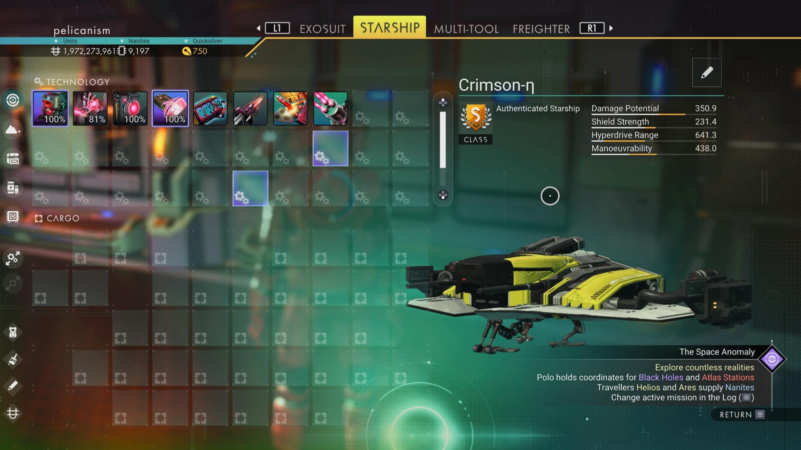

# Waypoint 38: Igueli-Sebad XVI

| | |
|---|---|
| Galaxy | Euclid |
| Distance from core | 1,076,540 LY |
| Jump from previous | 1,989 LY |
| Planet coordinates | -69.50, -145.35 |
| Glyphs | 40417476B76F |
| Ship as found | B-class, 38+27 slots |
| S-class ship | Crimson-η |
| S-class stats | Damage 350.9 · Shield 231.4 · Hyperdrive 641.3 · Manoeuvrability 438.0 |

> Found as Fire-ττ.

## Caption

_Not written yet._
