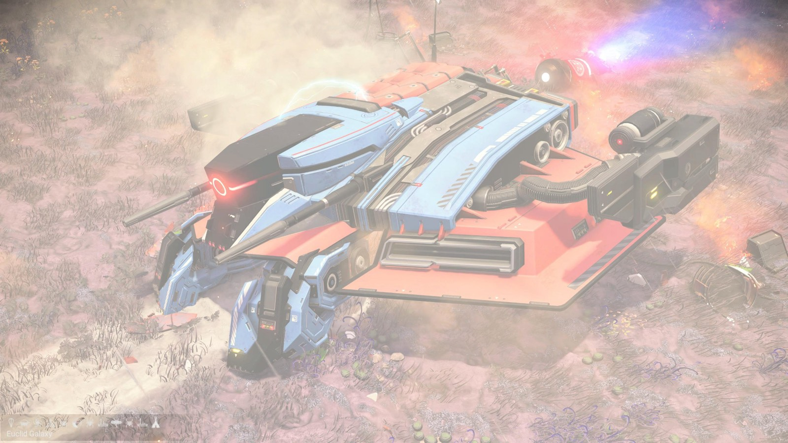
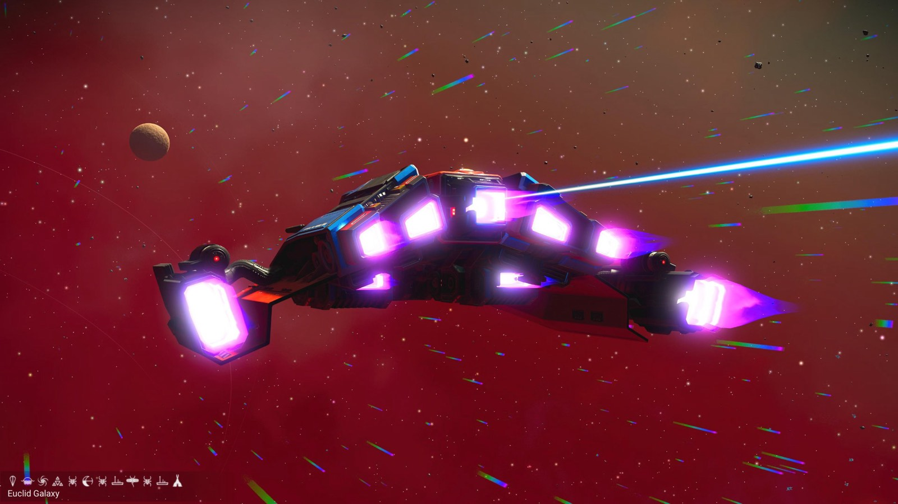
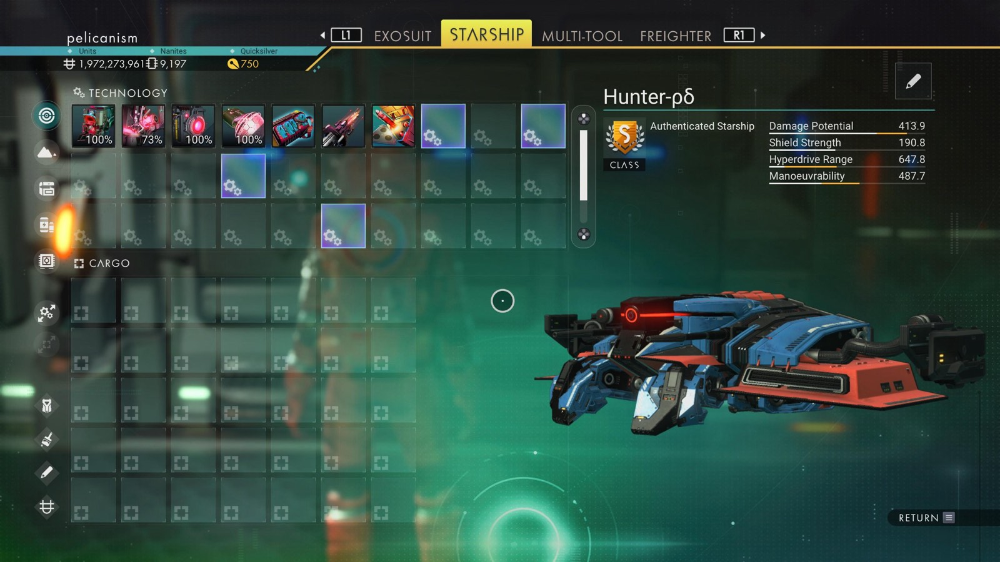

# Waypoint 39: Ofunami

| | |
|---|---|
| Galaxy | Euclid |
| Distance from core | 1,074,599 LY |
| Jump from previous | 1,941 LY |
| Planet coordinates | -61.81, -33.25 |
| Glyphs | 5B9F7476876C |
| Ship as found | B-class, 35+24 slots |
| S-class ship | Hunter-ρδ |
| S-class stats | Damage 413.9 · Shield 190.8 · Hyperdrive 647.8 · Manoeuvrability 487.7 |

> Found as Crimson-φπ.

## Caption

_Not written yet._
