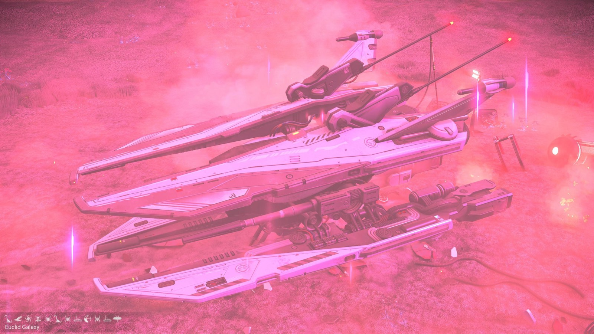
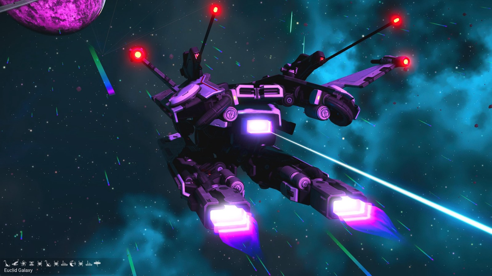
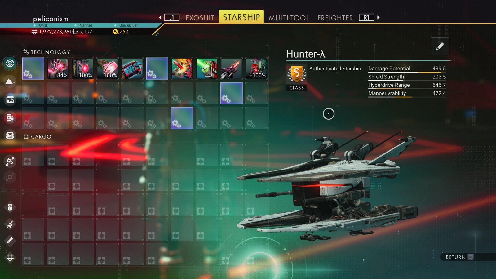

# Waypoint 40: Sibirs-Aangk

| | |
|---|---|
| Galaxy | Euclid |
| Distance from core | 1,072,564 LY |
| Jump from previous | 2,035 LY |
| Planet coordinates | +19.94, -5.15 |
| Glyphs | 319273764768 |
| Ship as found | C-class, 39+28 slots |
| S-class ship | Hunter-λ |
| S-class stats | Damage 439.5 · Shield 203.5 · Hyperdrive 646.7 · Manoeuvrability 472.4 |

> Found as Reforged-π.

## Caption

_Not written yet._
