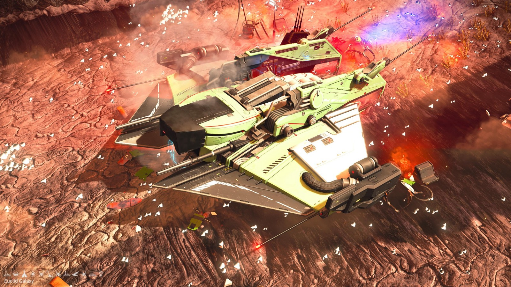
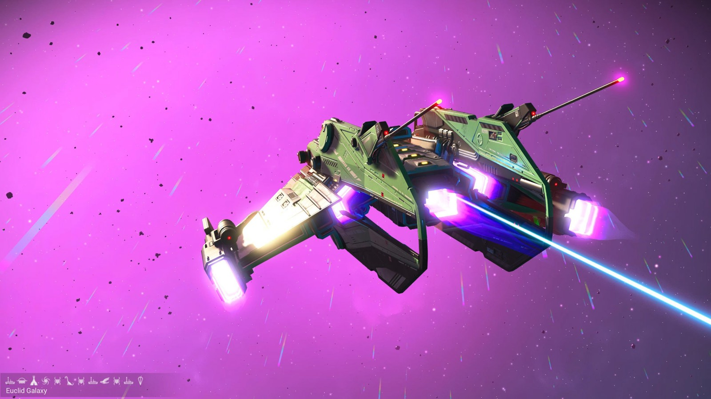
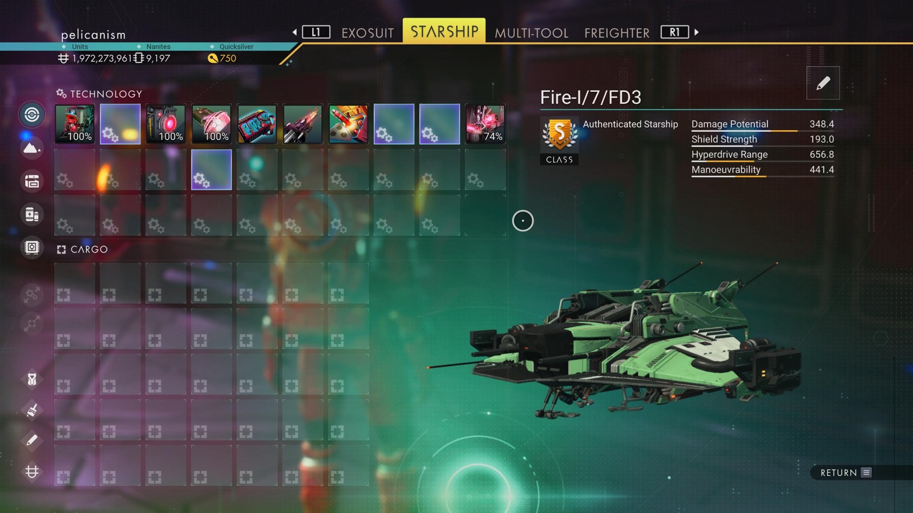

# Waypoint 41: Molarf-Seou

| | |
|---|---|
| Galaxy | Euclid |
| Distance from core | 1,070,659 LY |
| Jump from previous | 1,905 LY |
| Planet coordinates | -42.73, +162.08 |
| Glyphs | 6BC973761765 |
| Ship as found | C-class, 35+24 slots |
| S-class ship | Fire-I/7/FD3 |
| S-class stats | Damage 348.4 · Shield 193.0 · Hyperdrive 656.8 · Manoeuvrability 441.4 |

> Found as Reborn-P-5.

## Caption

_Not written yet._
