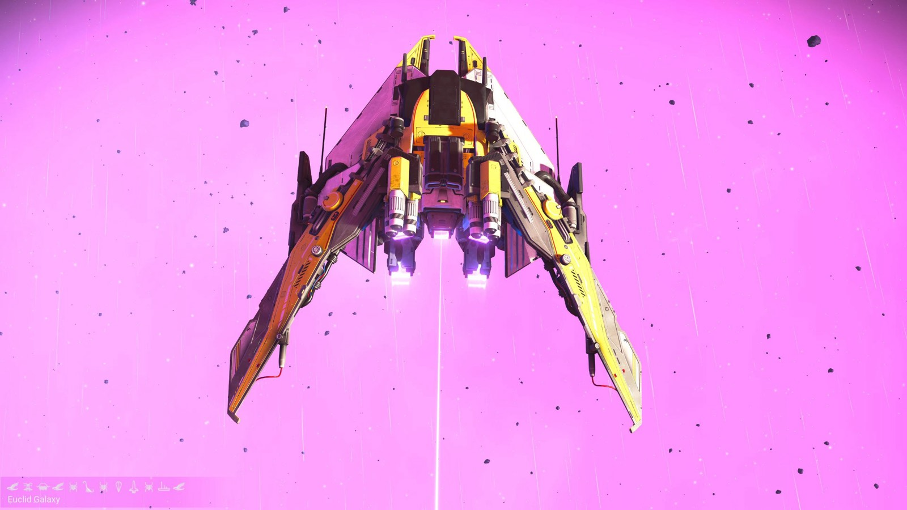
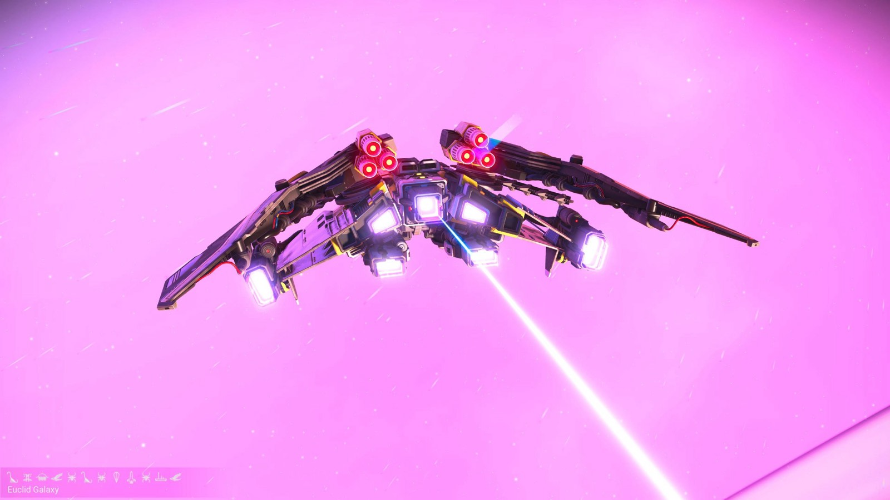

# Waypoint 42: Itabentv

| | |
|---|---|
| Galaxy | Euclid |
| Distance from core | 1,068,725 LY |
| Jump from previous | 1,934 LY |
| Planet coordinates | -41.42, +1.71 |
| Glyphs | 32B17375D761 |
| Ship as found | B-class, 37+26 slots |
| S-class ship | Remnant-δ |
| S-class stats | Damage 370.8 · Shield 198.3 · Hyperdrive 653.2 · Manoeuvrability 466.8 |

> Found as Shard-πο.

## Caption

_Not written yet._
