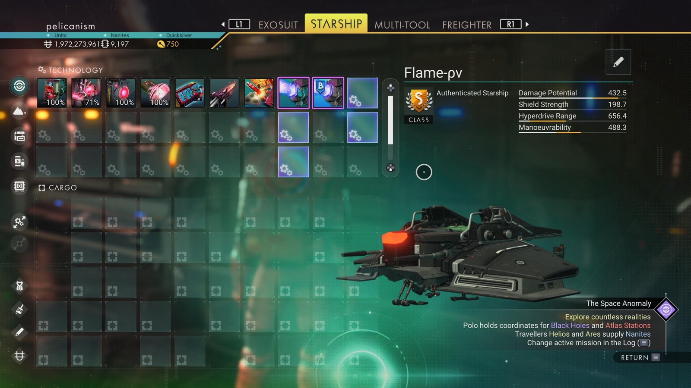

# Waypoint 43: Eklusko-Xoka

| | |
|---|---|
| Galaxy | Euclid |
| Distance from core | 1,066,670 LY |
| Jump from previous | 2,055 LY |
| Planet coordinates | -45.00, -90.20 |
| Glyphs | 407E7375A75E |
| Ship as found | A-class, 38+27 slots |
| S-class ship | Flame-ρν |
| S-class stats | Damage 432.5 · Shield 198.7 · Hyperdrive 656.4 · Manoeuvrability 488.3 |

> Found as θ-Purged.

## Caption

_Not written yet._
