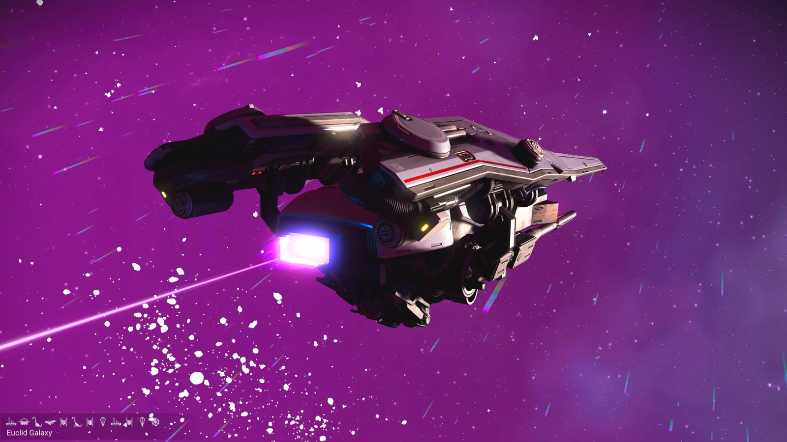
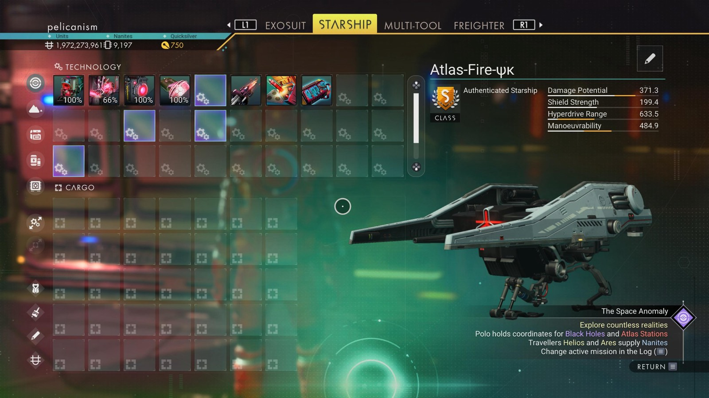

# Waypoint 44: Avirken-Aech

| | |
|---|---|
| Galaxy | Euclid |
| Distance from core | 1,064,606 LY |
| Jump from previous | 2,064 LY |
| Planet coordinates | -4.35, -109.38 |
| Glyphs | 603B7375675A |
| Ship as found | C-class, 35+24 slots |
| S-class ship | Atlas-Fire-ψκ |
| S-class stats | Damage 371.3 · Shield 199.4 · Hyperdrive 633.5 · Manoeuvrability 484.9 |

> Found as Salvaged-X/E72-I60.

## Caption

_Not written yet._
