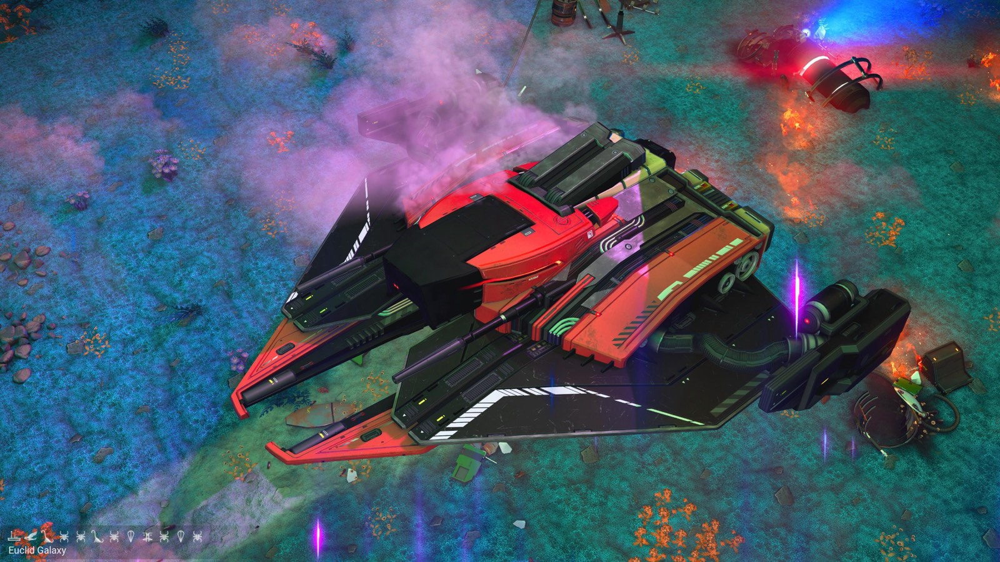
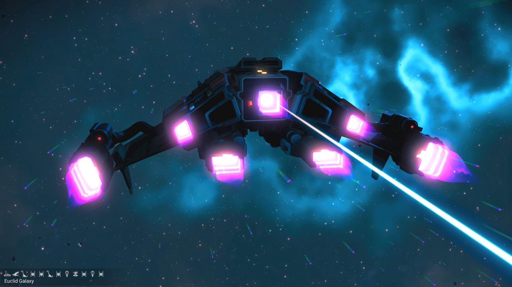
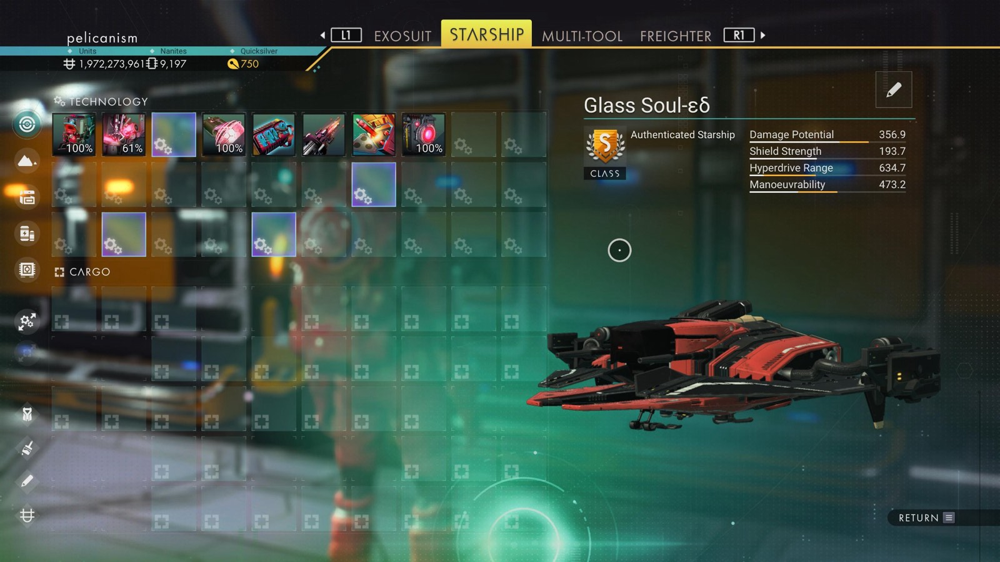

# Waypoint 45: Aitungri

| | |
|---|---|
| Galaxy | Euclid |
| Distance from core | 1,062,563 LY |
| Jump from previous | 2,043 LY |
| Planet coordinates | -67.11, -98.57 |
| Glyphs | 613773752757 |
| Ship as found | B-class, 37+26 slots |
| S-class ship | Glass Soul-εδ |
| S-class stats | Damage 356.9 · Shield 193.7 · Hyperdrive 634.7 · Manoeuvrability 473.2 |

> Found as Glass Soul-3G/Z32.

## Caption

_Not written yet._
