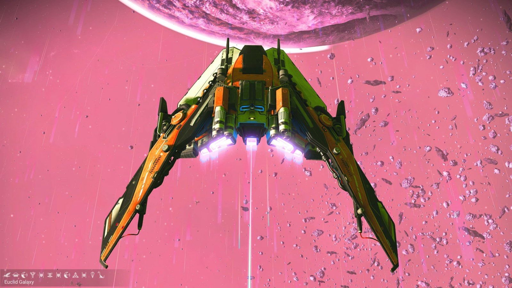
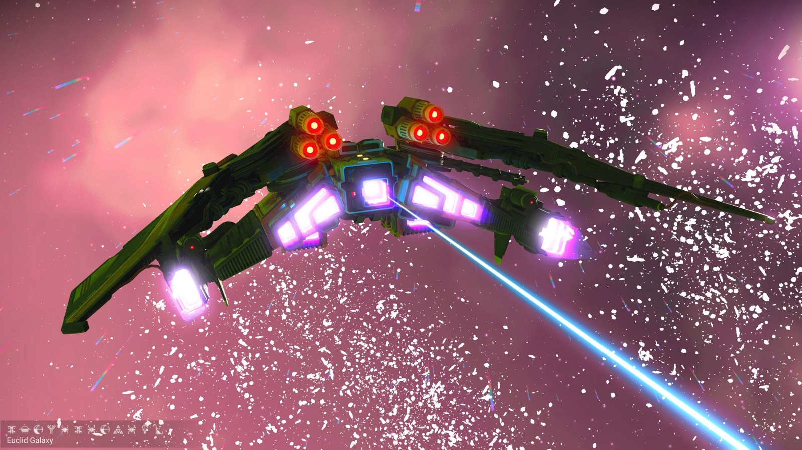
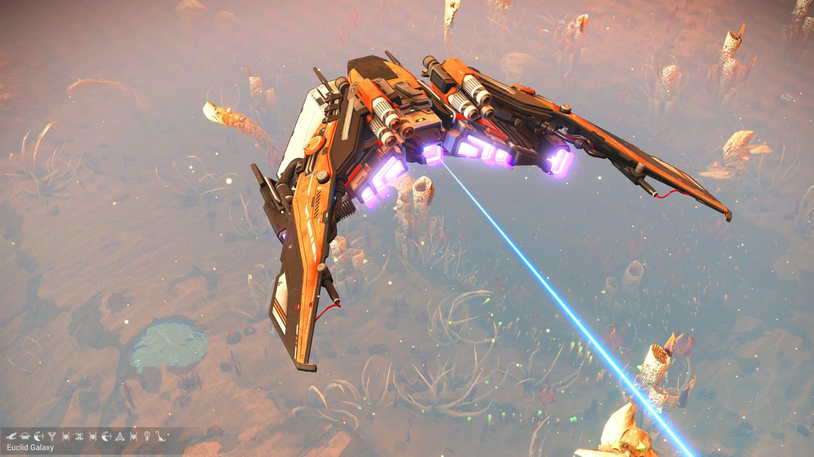
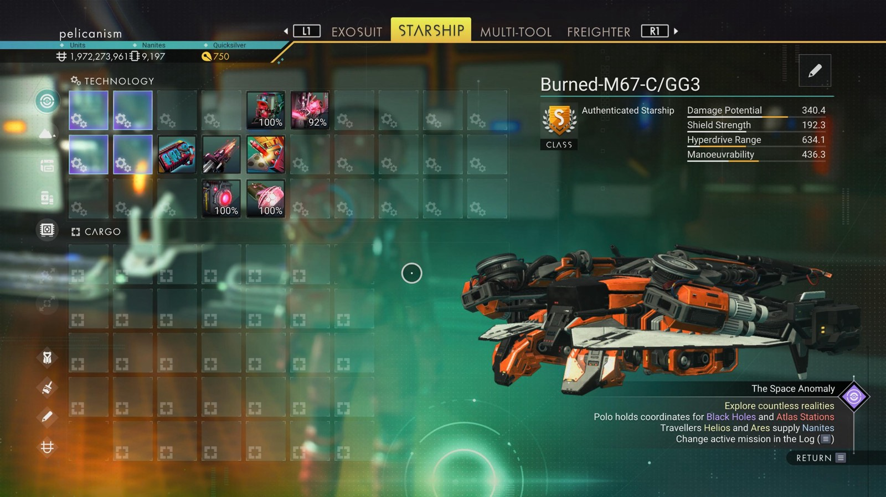

# Waypoint 46: Hetian-Sos

| | |
|---|---|
| Galaxy | Euclid |
| Distance from core | 1,060,748 LY |
| Jump from previous | 1,815 LY |
| Planet coordinates | -37.56, -140.03 |
| Glyphs | 204E7274F753 |
| Ship as found | C-class, 33+22 slots |
| S-class ship | Burned-M67-C/GG3 |
| S-class stats | Damage 340.4 · Shield 192.3 · Hyperdrive 634.1 · Manoeuvrability 436.3 |

> Found as Fragment-φ.

## Caption

_Not written yet._
